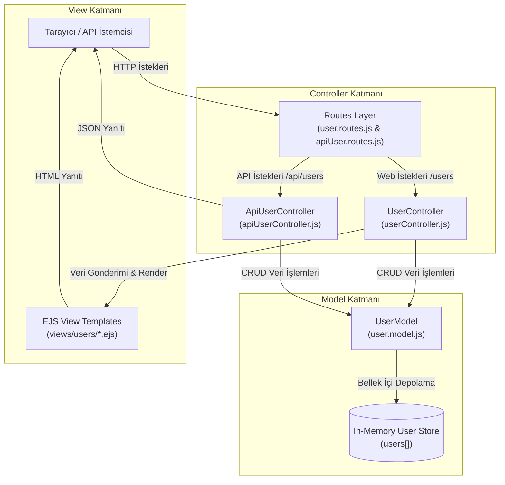
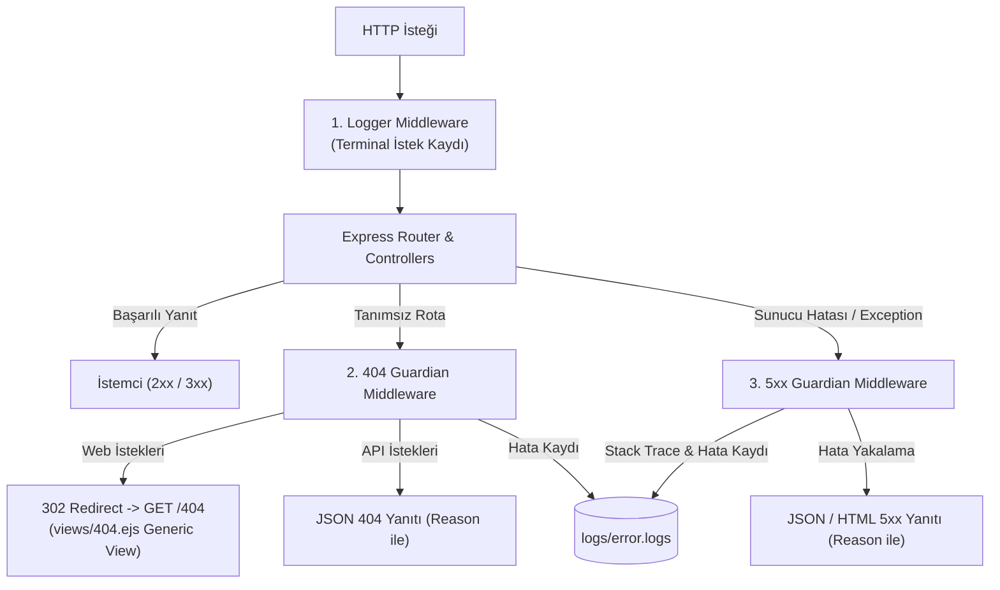

# 🎓 Alumni Tracking System (Mezun Takip Sistemi)

[](https://nodejs.org/)
[](https://expressjs.com/)
[](https://ejs.co/)
[](http://localhost:5000/api/swagger)
[](https://www.docker.com/)
[](https://opensource.org/licenses/MIT)

> **Web Programlama Dersi Dönem Projesi** — Üniversite mezunları, mevcut öğrenciler ve akademisyenleri bir araya getiren, hem **EJS tabanlı dinamik Web Görünüm (View)** katmanına hem de **JSON tabanlı REST API** mimarisine sahip tam teşekküllü **MVC (Model-View-Controller)** web platformu.

---

## 📌 İçindekiler

1. [Proje Özeti ve Temel Özellikler](#-proje-özeti-ve-temel-özellikler)
2. [MVC Mimarisi (Model-View-Controller)](#-mvc-mimarisi-model-view-controller)
   - [Mimari Genel Bakış](#mimari-genel-bakış)
   - [Dizin ve Dosya Hiyerarşisi](#dizin-ve-dosya-hiyerarşisi)
   - [Klasör ve Dosyaların Sorumlulukları](#klasör-ve-dosyaların-sorumlulukları)
   - [İstek Yaşam Döngüsü ve Veri Akışı](#istek-yaşam-döngüsü-ve-veri-akışı)
3. [Modeller ve Doğrulama Kuralları (Data Models)](#-modeller-ve-doğrulama-kuralları-data-models)
   - [Kullanıcı Modeli ve In-Memory CRUD](#-kullanıcı-modeli-ve-in-memory-crud)
   - [İş ve Staj İlanı Modeli (JobPosting) ve Doğrulama Kuralları](#iş-ve-staj-i̇lanı-modeli-jobposting-ve-doğrulama-kuralları)
4. [Kontrolcüler (Controllers)](#-kontrolcüler-controllers)
5. [View Katmanı (EJS Templates)](#-view-katmanı-ejs-templates)
6. [Uç Noktalar ve Rotalar (Endpoints)](#-uç-noktalar-ve-rotalar-endpoints)
7. [Middleware Mimarisi, İstek Günlükleme ve Hata Koruma (Guardians & Logging)](#-middleware-mimarisi-i̇stek-günlükleme-ve-hata-koruma-guardians--logging)
   - [Logger Middleware (Terminal Formatı)](#1-logger-middleware-srcmiddlewareloggermiddlewarejs)
   - [404 Guardian Middleware & Generic 404 Sayfası](#2-404-guardian-middleware--generic-404-sayfası)
   - [5xx Guardian Middleware (Sunucu Hata Yakalayıcısı)](#3-5xx-guardian-middleware-srcmiddlewareservererrorguardianmiddlewarejs)
   - [Dosya Tabanlı Hata Günlüğü (logs/error.logs)](#4-dosya-tabanlı-hata-günlüğü-logserrorlogs)
8. [Swagger & OpenAPI Dokümantasyonu](#-swagger--openapi-dokümantasyonu)
9. [Veri Tasarımı Dokümantasyonu (ddd.md)](#-veri-tasarımı-dokümantasyonu-dddmd)
10. [Git Dal Yönetimi ve Dal Dokümantasyonu (branch.md)](#-git-dal-yönetimi-ve-dal-dokümantasyonu-branchmd)
11. [Çevresel Değişkenler (.env ve example.env)](#-çevresel-değişkenler-env-ve-exampleenv)
12. [Kurulum, Çalıştırma ve Testler](#-kurulum-çalıştırma-ve-testler)
13. [Docker Desteği ve "The Forgetting Test" Sırrı](#-docker-desteği-ve-the-forgetting-test-sırrı)
14. [Geliştirici Bilgileri](#-geliştirici-bilgileri)

---

## 📌 Proje Özeti ve Temel Özellikler

**Alumni Tracking System**, üniversite mezunlarının kariyer yolculuklarını güncellemelerine, mevcut öğrencilerle mentörlük ve deneyim paylaşımı bağı kurmalarına, staj ve iş imkanlarını paylaşmalarına olanak tanıyan modern bir web uygulamasıdır.

- **👤 Mezun ve Öğrenci Yönetimi:** Profil bilgileri, bölüm, mezuniyet yılı, iletişim ve rol yönetimi (STUDENT, ALUMNI, ADMIN).
- **🖥️ İkili Arayüz Desteği:**
  - **Sunucu Taraflı Görünüm (SSR):** EJS şablonlama motoru ile render edilen zengin ve kullanıcı dostu HTML arayüzü (`/users`).
  - **RESTful JSON API:** Mobil ve harici istemciler için standart JSON yanıtları üreten API uç noktaları (`/api/users`).
- **📚 İnteraktif Swagger Dokümantasyonu:** OpenAPI 3.0 standardında tüm Web ve API uç noktalarını listeleyen ve test imkanı sunan Swagger UI (`/api/swagger`).
- **⚡ In-Memory Veri Modeli:** Harici veritabanı kurulumuna ihtiyaç duymadan tam CRUD işlemlerini destekleyen ve başlangıç örnek verileriyle (seed) gelen model mimarisi.
- **🛡️ Gelişmiş Middleware & Hata Koruma (Guardians):** Terminal konsoluna biçimlendirilmiş istek loglama (`time method route restype duration`), geçersiz web isteklerini Generic 404 sayfasına yönlendiren 404 Guardian, 5xx sunucu hatalarını gerekçesiyle yakalayan 5xx Guardian ve `logs/error.logs` kalıcı günlükleme sistemi.
- **🧪 Kapsamlı Otomatik Test Paketi:** Node.js yerleşik test kütüphanesi (`node:test`) ile uçtan uca hazırlanmış **59 adet** otomatik test senaryosu.

---

## 🏛️ MVC Mimarisi (Model-View-Controller)

Uygulama, yazılım mühendisliği standartlarına uygun olarak sorumlulukların net biçimde ayrıldığı **Model-View-Controller (MVC)** mimari deseniyle tasarlanmıştır.

### Mimari Genel Bakış



---

### Dizin ve Dosya Hiyerarşisi

Projenin dizin ve dosya organizasyonu aşağıda gösterilmiştir:

```plaintext
alumni/
├── index.js                      # Ana uygulama giriş noktası (Web + API sunucusu)
├── package.json                  # Proje bağımlılıkları ve npm betikleri (ES Modules)
├── package-lock.json             # Kilitlenmiş bağımlılık versiyonları
├── Dockerfile                    # Docker imajı yapılandırma dosyası
├── docker-compose.yml            # Docker Compose servis tanımı
├── README.md                     # Kapsamlı proje ve mimari dokümantasyonu
├── ddd.md                        # Veri tasarımı ve mimari dokümantasyonu
├── branch.md                     # Git dal yönetimi ve geçici dallar dokümantasyonu
│
├── logs/                         # Hata günlükleri dizini
│   ├── .gitkeep                  # Git takip dosyası
│   └── error.logs                # 4xx ve 5xx hata kayıtları günlüğü (git-ignored)
│
├── src/                          # Kaynak kod kök dizini
│   ├── app.js                    # Express app yapılandırması (Middleware'ler, rotalar)
│   ├── server.js                 # Sunucu dinleme ve graceful shutdown yönetimi
│   │
│   ├── config/                   # Yapılandırma katmanı
│   │   ├── environment.js        # Port ve çalışma ortamı değişkenleri
│   │   └── swagger.js            # OpenAPI 3.0 dokümantasyon şeması (Kullanıcı, Duyuru, İş, Başvuru vb.)
│   │
│   ├── middleware/               # MIDDLEWARE KATMANI (İstek/Hata Koruyucuları)
│   │   ├── index.js              # Middleware dışa aktarım merkezi (registry)
│   │   ├── logger.middleware.js  # Terminal istek loglayıcısı ve dosya loglayıcı
│   │   ├── notFoundGuardian.middleware.js   # 404 koruyucusu ve web redirect
│   │   └── serverErrorGuardian.middleware.js # 5xx merkezi hata yakalayıcısı
│   │
│   ├── models/                   # MODEL KATMANI (Veri ve İş Mantığı)
│   │   ├── user.model.js         # In-memory User modeli ve tam CRUD fonksiyonları
│   │   ├── announcement.model.js # In-memory Announcement modeli ve tam CRUD
│   │   ├── jobPosting.model.js   # İş İlanı modeli ve doğrulama kuralları (120 char kısıtı)
│   │   ├── jobApplication.model.js # N:M Başvuru yaşam döngüsü modeli
│   │   └── ...                   # Event, Profile, Mentorship modelleri
│   │
│   ├── controllers/              # CONTROLLER KATMANI (İstek/Yanıt Yöneticileri)
│   │   ├── userController.js     # Kullanıcı Web Görünüm Kontrolcüsü (EJS render)
│   │   ├── apiUserController.js  # Kullanıcı REST API Kontrolcüsü (JSON yanıt)
│   │   ├── jobController.js      # İş İlanı Web Kontrolcüsü
│   │   ├── apiJobController.js   # İş İlanı REST API Kontrolcüsü
│   │   ├── announcementController.js    # Duyuru Web Görünüm Kontrolcüsü
│   │   ├── apiAnnouncementController.js # Duyuru REST API Kontrolcüsü
│   │   └── ...
│   │
│   └── routes/                   # ROTA KATMANI (URL Eşleştirmeleri)
│       ├── index.js              # API rotaları toplayıcısı ve Swagger mount
│       ├── direct.routes.js      # Statik sayfalar ve /404 Generic hata sayfası rotası
│       ├── user.routes.js        # /users Web Görünüm rotaları
│       ├── apiUser.routes.js     # /api/users REST API rotaları
│       ├── job.routes.js         # /jobs Web rotaları
│       ├── apiJob.routes.js      # /api/jobs REST API rotaları
│       └── ...
│
├── views/                        # VIEW KATMANI (EJS Şablonları)
│   ├── 404.ejs                   # Özel tasarlanmış Generic 404 Hata Sayfası
│   ├── error.ejs                 # Genel sunucu hata sayfası (500 vb.)
│   ├── partials/                 # Yeniden kullanılabilir parçalı şablonlar
│   │   ├── header.ejs            # HTML başlık, navigasyon çubuğu ve modern CSS stilleri
│   │   └── footer.ejs            # Sayfa altlığı ve telif/bağlantı alanı
│   ├── users/                    # Kullanıcı Yönetimi Görünümleri
│   ├── jobs/                     # İş ve Staj İlanları Görünümleri
│   ├── applications/             # Başvuru Yönetimi Görünümleri
│   ├── announcements/            # Duyuru Yönetimi Görünümleri
│   └── events/                   # Etkinlik Yönetimi Görünümleri
│
├── public/                       # Statik Web Varlıkları
│   ├── index.html                # Hoş geldiniz ana sayfası ve bağlantı dizini
│   └── about.html                # Proje ve teknoloji yığını hakkında sayfası
│
└── test/                         # Otomatik Test Paketi
    └── index.test.js             # node:test ile yazılmış 59 adet uçtan uca test
```

---

### Klasör ve Dosyaların Sorumlulukları

| Katman / Dizin | Dosya Adı | Rol ve Sorumluluk (Single Responsibility) |
| :--- | :--- | :--- |
| **Model** | `src/models/user.model.js` | Veritabanı bağımsız bellek içi veri deposunu yönetir. E-posta format ve benzersizlik kontrolü, otomatik ID üretimi, zaman damgaları (`created_at`, `updated_at`), filtreleme/arama ve CRUD (`getAll`, `getById`, `getByEmail`, `create`, `update`, `patch`, `delete`) işlevlerini gerçekleştirir. |
| **Controller (Web)** | `src/controllers/userController.js` | Web arayüzü isteklerini karşılar. Modelden veriyi alır, EJS şablonlarını (`render`) çalıştırır, form işlemlerinde yönlendirme (`redirect`) yapar. |
| **Controller (API)** | `src/controllers/apiUserController.js` | Harici istemciler ve API istekleri için HTTP durum kodları (`200 OK`, `201 Created`, `400 Bad Request`, `404 Not Found`, `409 Conflict`) ile biçimlendirilmiş JSON yanıtları döner. |
| **View (EJS)** | `views/users/*.ejs` | Kullanıcının tarayıcıda gördüğü HTML arayüzüdür. Model verisini görselleştirir, kullanıcıdan form girdilerini alır ve aksiyon butonları (Detay, Düzenle, Sil) sunar. |
| **View Partials** | `views/partials/` | `header.ejs` navigasyon ve ortak responsive stilleri, `footer.ejs` alt bilgi ve hızlı bağlantıları içerir. Tüm sayfalarda kod tekrarını önler. |
| **Routes** | `src/routes/user.routes.js` | `/users` altındaki Web isteklerini (GET, POST, PUT, DELETE) `UserController` fonksiyonlarına yönlendirir. |
| **Routes** | `src/routes/apiUser.routes.js` | `/api/users` altındaki REST API isteklerini `ApiUserController` fonksiyonlarına yönlendirir. |
| **Config** | `src/config/swagger.js` | Hem `/users` web rotalarını hem de `/api/users` API rotalarını kapsayan OpenAPI 3.0 dokümantasyon şemasını barındırır. |
| **Entry Point** | `index.js` | EJS motorunu, middleware'leri (`express.json`, `urlencoded`, `methodOverride`, `static`), rotaları bağlar ve sunucuyu başlatır. |
| **Middleware** | `src/middleware/logger.middleware.js` | Her HTTP isteğini terminale `time method route restype duration` formatında (örn: `10:20:30 POST /user 201 18ms`) yazar ve hata durumlarında dosyaya yazma fonksiyonunu (`writeErrorLog`) sağlar. |
| **Middleware** | `src/middleware/notFoundGuardian.middleware.js` | Tanımsız rotaları yakalayan 404 koruyucusudur. Geçersiz web isteklerini `302 Redirect` ile `/404` generic sayfasına yönlendirir, REST API isteklerine `reason` gerekçeli JSON döner ve `logs/error.logs` dosyasına kaydeder. |
| **Middleware** | `src/middleware/serverErrorGuardian.middleware.js` | Merkezi 5xx Express hata yakalama ara yazılımıdır. Beklenmeyen istisnaları yakalar, sistem çökmesini engeller, açıklayıcı `reason` üretir ve stack trace ile birlikte `logs/error.logs` dosyasına kaydeder. |
| **View (404)** | `views/404.ejs` | Özel tasarlanmış Generic 404 Hata Sayfası. İstemcinin yönlendirildiği geçersiz URL'yi, hata gerekçesini ve hızlı gezinti butonlarını sunar. |
| **Logs** | `logs/error.logs` | Uygulamada meydana gelen 4xx ve 5xx hata olaylarının kronolojik olarak saklandığı günlük dosyasıdır. |
| **Git Docs** | `branch.md` | Projede uygulanan Git dallanma stratejisini (branching strategy), oluşturulan geçici dalları (`temp-homepage-design`) ve dal yönetim komutlarını belgeler. |

---

### İstek Yaşam Döngüsü ve Veri Akışı

1. **Web Kullanıcısı (Tarayıcı Akışı):**
   - Kullanıcı tarayıcıda `GET /users` adresine gider.
   - `index.js` isteği `src/routes/user.routes.js` rotasına iletir.
   - Rota, `UserController.listUsers` fonksiyonunu tetikler.
   - `UserController`, `userModel.getAll()` çağrısı yaparak modelden güncel kullanıcı listesini alır.
   - Kontrolcü, veriyi `views/users/index.ejs` şablonuna aktarır ve HTML oluşturup istemciye döner.

2. **Web Formu ile Kullanıcı Ekleme (Create Akışı):**
   - Kullanıcı `/users/new` sayfasındaki formu doldurup gönderir (`POST /users`).
   - `UserController.createUser` form verisini (`req.body`) alır ve `userModel.create(userData)` fonksiyonuna gönderir.
   - Model veriyi doğrular, ID ve zaman damgası atar, listeye ekler.
   - Kontrolcü başarılı ekleme sonrası tarayıcıyı `302 Redirect` ile `/users` sayfasına yönlendirir.

3. **REST API İstemcisi Akışı:**
   - İstemci `POST /api/users` adresine JSON gövdesiyle istek atar.
   - Rota isteği `ApiUserController.createUser` fonksiyonuna ulaştırır.
   - Kontrolcü modeli çağırır ve istemciye `201 Created` durum koduyla oluşturulan nesneyi JSON olarak döner.

---

## 📦 Modeller ve Doğrulama Kuralları (Data Models)

### 1. Kullanıcı Modeli (User) ve In-Memory CRUD

`src/models/user.model.js` dosyası herhangi bir harici veritabanına bağlı olmaksızın çalışan saf JavaScript sınıfıdır. Başlangıçta sistemde 3 adet gerçekçi örnek kullanıcı (Rumeysa Aydın, Ahmet Yılmaz, Zeynep Kaya) ile tohumlanır (seed).

### Model Şeması

```javascript
{
  id: 1,                                       // Otomatik artan tekil sayısal kimlik
  first_name: "Rumeysa",                       // Kullanıcı adı
  last_name: "Aydın",                          // Kullanıcı soyadı
  email: "rumeysa.aydin@alumni.edu",           // Benzersiz e-posta
  password: "password123",                     // Şifre
  role: "ALUMNI",                              // Rol: 'STUDENT' | 'ALUMNI' | 'ADMIN'
  department: "Yönetim Bilişim Sistemleri",   // Bölüm / Program
  graduation_year: 2024,                       // Mezuniyet yılı
  is_verified: true,                           // Doğrulanma durumu
  created_at: "2026-09-30T07:35:56.824Z",      // Oluşturulma zamanı
  updated_at: null                             // Son güncelleme zamanı
}
```

### Model CRUD Metotları

- `getAll({ search, role, department })`: Kullanıcıları arama ve filtreleme kriterlerine göre döndürür.
- `getById(id)`: Sayısal ID'ye göre tekil kullanıcı getirir.
- `getByEmail(email)`: E-posta adresiyle kullanıcı bulur (çift kayıtları engeller).
- `create(userData)`: E-posta ve rol doğrulaması yaparak yeni kayıt oluşturur.
- `update(id, updateData)`: Kullanıcı bilgilerini bütünüyle günceller (`updated_at` ekler).
- `patch(id, partialData)`: Sadece iletilen alanları günceller.
- `delete(id)`: Kullanıcı kaydını bellekten siler.
- `reset()`: Test senaryoları için veriyi başlangıç durumuna döndürür.

### 2. İş ve Staj İlanı Modeli (JobPosting) ve Doğrulama Kuralları

`src/models/jobPosting.model.js` dosyası iş ve staj ilanlarını bellek içinde yönetir. İş kuralları gereği aşağıdaki veri doğrulama kısıtları hem Model hem Controller seviyesinde garanti altına alınmıştır:

- **`title` (İlan Başlığı):** **Zorunlu** (`required`). Maksimum **120 karakter** ile sınırlandırılmıştır (`maxLength: 120`). 120 karakterden uzun başlık girilmesi durumunda `400 Bad Request` hatası döner; EJS formunda `maxlength="120"` HTML özniteliği ile kısıtlanır.
- **`company` (Firma Adı):** **Zorunlu** (`required`). Boş veya tanımsız bırakılamaz.
- **`city` (Şehir / Konum):** **İsteğe Bağlı** (`optional`). Belirtilmediğinde varsayılan olarak boş/null kabul edilir.
- **`description` (İş Tanımı ve Detaylar):** **İsteğe Bağlı** (`optional`). Zorunlu değildir.
- **`type` (İstihdam Türü):** `FULL_TIME`, `PART_TIME`, `INTERNSHIP`, `REMOTE` seçeneklerini destekler.

---

## 🎮 Kontrolcüler (Controllers)

İki ayrı kullanım amacına hizmet eden iki bağımsız kontrolcü geliştirilmiştir:

### 1. `UserController` (`src/controllers/userController.js`)
Tarayıcı tabanlı kullanıcı etkileşimini ve EJS görünümlerini yönetir:
- `listUsers`: Kullanıcı listesini (`views/users/index.ejs`) arama ve filtre seçenekleriyle render eder.
- `showUser`: Tekil profil detay sayfasını (`views/users/show.ejs`) render eder.
- `renderCreateForm`: Yeni kayıt formunu (`views/users/new.ejs`) render eder.
- `createUser`: Formdan gelen `POST /users` isteğini işler, kullanıcıyı ekler ve yönlendirir.
- `renderEditForm`: Düzenleme formunu (`views/users/edit.ejs`) mevcut verilerle dolu olarak render eder.
- `updateUser`: `POST /users/:id` form isteğiyle kullanıcıyı günceller ve detay sayfasına yönlendirir.
- `deleteUser`: `POST /users/:id/delete` form isteğiyle kullanıcıyı siler ve listeye yönlendirir.

### 2. `ApiUserController` (`src/controllers/apiUserController.js`)
Programatik istemcilere saf JSON yanıtları üretir:
- `getUsers`: `200 OK` & `{ success: true, count, data: [...] }`
- `getUserById`: `200 OK` & `{ success: true, data: user }` veya `404 Not Found`
- `createUser`: `201 Created` & `{ success: true, message, data: newUser }` veya `400/409`
- `updateUser`: `200 OK` (tam güncelleme - PUT) veya `404/400`
- `patchUser`: `200 OK` (kısmi güncelleme - PATCH) veya `404/400`
- `deleteUser`: `200 OK` (silme - DELETE) & `{ success: true, message, data: deletedUser }`

---

## 🎨 View Katmanı (EJS Templates)

Uygulamanın arayüz katmanı `views/` dizininde modern, responsive ve CSS bağımlılığı gerektirmeyen gömülü stillerle hazırlanmıştır:

- **Navigasyon ve Header (`views/partials/header.ejs`):** Sabit üst menü, marka simgesi, sayfa bağlantıları ve "+ Yeni Kullanıcı" hızlı butonu.
- **Kullanıcı Listesi (`views/users/index.ejs` - R):**
  - İsim, e-posta veya bölüme göre canlı arama alanı.
  - Rol filtresi (ALUMNI, STUDENT, ADMIN).
  - Kullanıcı kartları / tablosu, rol rozetleri, onay durumu rozetleri.
  - "Detay", "Düzenle" ve JavaScript onay pencereli "Sil" butonları.
- **Yeni Kullanıcı Formu (`views/users/new.ejs` - C):** Ad, soyad, e-posta, şifre, rol, bölüm, mezuniyet yılı ve onay durumu alanları.
- **Kullanıcı Detay Sayfası (`views/users/show.ejs` - R):** Kullanıcının tüm kayıt bilgilerini, tarih damgalarını ve ilgili JSON API bağlantısını gösteren profil kartı.
- **Kullanıcı Düzenleme Formu (`views/users/edit.ejs` - U):** Mevcut verileri otomatik yüklenmiş form üzerinden güncelleme imkanı.
- **Hata Sayfası (`views/error.ejs`):** 404 ve 500 durumlarında kullanıcı dostu geri dönüş arayüzü.

---

## 🔌 Uç Noktalar ve Rotalar (Endpoints)

### 🌐 Web Görünüm Rotaları (MVC View Layer)

#### Kullanıcı Yönetimi
| HTTP Metodu | Rota | Açıklama | Katman / Sonuç |
| :--- | :--- | :--- | :--- |
| `GET` | `/users` | Tüm kullanıcıların listesi, arama ve filtreleme | View (`users/index.ejs`) |
| `GET` | `/users/new` | Yeni kullanıcı oluşturma formu | View (`users/new.ejs`) |
| `POST` | `/users` | Yeni kullanıcı oluşturma form gönderimi (C) | Controller -> Redirect `/users` |
| `GET` | `/users/:id` | Tekil kullanıcı profil detay sayfası (R) | View (`users/show.ejs`) |
| `GET` | `/users/:id/edit` | Kullanıcı bilgileri düzenleme formu | View (`users/edit.ejs`) |
| `POST` | `/users/:id` | Kullanıcı bilgilerini güncelleme (U) | Controller -> Redirect `/users/:id` |
| `POST` | `/users/:id/delete` | Kullanıcıyı silme işlemi (D) | Controller -> Redirect `/users` |

#### Duyuru Yönetimi
| HTTP Metodu | Rota | Açıklama | Katman / Sonuç |
| :--- | :--- | :--- | :--- |
| `GET` | `/announcements` | Tüm duyuruların listesi, arama ve kategori filtresi | View (`announcements/index.ejs`) |
| `GET` | `/announcements/new` | Yeni duyuru oluşturma formu | View (`announcements/new.ejs`) |
| `POST` | `/announcements` | Yeni duyuru ekleme form gönderimi (C) | Controller -> Redirect `/announcements` |
| `GET` | `/announcements/:id` | Tekil duyuru detay sayfası (R) | View (`announcements/show.ejs`) |
| `GET` | `/announcements/:id/edit` | Duyuru bilgileri düzenleme formu | View (`announcements/edit.ejs`) |
| `POST` | `/announcements/:id` | Duyuru bilgilerini güncelleme (U) | Controller -> Redirect `/announcements/:id` |
| `POST` | `/announcements/:id/delete` | Duyuruyu silme işlemi (D) | Controller -> Redirect `/announcements` |

#### İş ve Staj İlanları Yönetimi
| HTTP Metodu | Rota | Açıklama | Katman / Sonuç |
| :--- | :--- | :--- | :--- |
| `GET` | `/jobs` | Tüm iş ve staj ilanlarının listesi, arama ve filtreleme | View (`jobs/index.ejs`) |
| `GET` | `/jobs/new` | Yeni ilan oluşturma formu | View (`jobs/new.ejs`) |
| `POST` | `/jobs` | Yeni ilan ekleme form gönderimi (C) | Controller -> Redirect `/jobs` |
| `GET` | `/jobs/:id` | Tekil ilan detayları, aranan şartlar ve başvuru alanı (R) | View (`jobs/show.ejs`) |
| `GET` | `/jobs/:id/edit` | İlan bilgileri düzenleme formu | View (`jobs/edit.ejs`) |
| `POST` | `/jobs/:id` | İlan bilgilerini güncelleme (U) | Controller -> Redirect `/jobs/:id` |
| `POST` | `/jobs/:id/delete` | İlanı silme işlemi (D) | Controller -> Redirect `/jobs` |
| `POST` | `/jobs/:id/apply` | İlana Alumni hesabı ile başvuru yapma | Controller -> Redirect `/jobs/:id` |

#### İş ve Staj Başvuruları (N:M Action Table)
| HTTP Metodu | Rota | Açıklama | Katman / Sonuç |
| :--- | :--- | :--- | :--- |
| `GET` | `/applications` | Tüm başvuruların listesi, durum ve ilan/aday filtresi | View (`applications/index.ejs`) |
| `GET` | `/applications/new` | Yeni başvuru oluşturma formu | View (`applications/new.ejs`) |
| `POST` | `/applications` | Yeni başvuru gönderme (C - Action) | Controller -> Redirect `/applications/:id` |
| `GET` | `/applications/:id` | Başvuru detayı, aday ve ilan bilgileri, durum yönetimi | View (`applications/show.ejs`) |
| `POST` | `/applications/:id/status` | Başvuru durumunu ve değerlendirme notunu güncelleme | Controller -> Redirect `/applications/:id` |
| `POST` | `/applications/:id/withdraw` | Başvuruyu aday tarafından geri çekme | Controller -> Redirect `/applications/:id` |
| `POST` | `/applications/:id/delete` | Başvuru kaydını silme | Controller -> Redirect `/applications` |

#### Etkinlikler ve Buluşmalar
| HTTP Metodu | Rota | Açıklama | Katman / Sonuç |
| :--- | :--- | :--- | :--- |
| `GET` | `/events` | Tüm etkinliklerin listesi ve arama | View (`events/index.ejs`) |
| `GET` | `/events/new` | Yeni etkinlik oluşturma formu | View (`events/new.ejs`) |
| `POST` | `/events` | Yeni etkinlik form gönderimi (C) | Controller -> Redirect `/events` |
| `GET` | `/events/:id` | Etkinlik detayı, kayıtlı katılımcılar ve kontenjan (R) | View (`events/show.ejs`) |
| `GET` | `/events/:id/edit` | Etkinlik düzenleme formu | View (`events/edit.ejs`) |
| `POST` | `/events/:id` | Etkinlik bilgilerini güncelleme (U) | Controller -> Redirect `/events/:id` |
| `POST` | `/events/:id/delete` | Etkinliği silme işlemi (D) | Controller -> Redirect `/events` |
| `POST` | `/events/:id/register` | Etkinliğe katılım kaydı oluşturma | Controller -> Redirect `/events/:id` |

### ⚡ REST API Rotaları (JSON API Layer)

| HTTP Metodu | Rota | Açıklama | Yanıt Tipi |
| :--- | :--- | :--- | :--- |
| `GET` | `/api/users` | Tüm kullanıcıları JSON formatında listele | `200 OK` (JSON) |
| `POST` | `/api/users` | Yeni kullanıcı oluştur (JSON / Form-data) | `201 Created` (JSON) |
| `GET` | `/api/users/:id` | ID ile tekil kullanıcı detayını getir | `200 OK` / `404 Not Found` |
| `PUT` | `/api/users/:id` | Kullanıcı kaydını tam güncelle | `200 OK` / `404 Not Found` |
| `PATCH` | `/api/users/:id` | Kullanıcı kaydını kısmi güncelle | `200 OK` / `404 Not Found` |
| `DELETE` | `/api/users/:id` | Kullanıcı kaydını sil | `200 OK` / `404 Not Found` |
| `GET` | `/api/announcements` | Tüm duyuruları JSON formatında listele | `200 OK` (JSON) |
| `POST` | `/api/announcements` | Yeni duyuru oluştur (JSON / Form-data) | `201 Created` (JSON) |
| `GET` | `/api/announcements/:id` | ID ile tekil duyuru detayını getir | `200 OK` / `404 Not Found` |
| `PUT` | `/api/announcements/:id` | Duyuru kaydını tam güncelle | `200 OK` / `404 Not Found` |
| `PATCH` | `/api/announcements/:id` | Duyuru kaydını kısmi güncelle | `200 OK` / `404 Not Found` |
| `DELETE` | `/api/announcements/:id` | Duyuru kaydını sil | `200 OK` / `404 Not Found` |
| `GET` | `/api/jobs` | İş ve staj ilanlarını filtreleyerek listele | `200 OK` (JSON) |
| `POST` | `/api/jobs` | Yeni iş/staj ilanı yayınla | `201 Created` (JSON) |
| `GET` | `/api/jobs/:id` | Tekil ilan detayları ve ilan sahibi mezun | `200 OK` / `404 Not Found` |
| `PUT` | `/api/jobs/:id` | İlan bilgilerini güncelle | `200 OK` / `404 Not Found` |
| `DELETE` | `/api/jobs/:id` | İlanı sil | `200 OK` / `404 Not Found` |
| `POST` | `/api/jobs/:id/apply` | İlana başvuru yap (N:M İlişki) | `201 Created` / `409 Conflict` |
| `GET` | `/api/jobs/:id/applications` | İlana başvuran tüm adaylar | `200 OK` (JSON) |
| `GET` | `/api/applications` | Tüm başvuruları listele ve filtrele (?status=&job_id=&user_id=) | `200 OK` (JSON) |
| `POST` | `/api/applications` | Doğrudan başvuru oluştur (N:M Action) | `201 Created` / `409 Conflict` |
| `GET` | `/api/applications/:id` | Tekil başvuru detayı, ilişkili ilan ve aday | `200 OK` / `404 Not Found` |
| `PUT` | `/api/applications/:id` | Başvuru bilgilerini tam güncelle | `200 OK` / `404 Not Found` |
| `PUT` | `/api/applications/:id/status` | Başvuru durumunu ve notunu güncelle | `200 OK` / `404 Not Found` |
| `POST` | `/api/applications/:id/withdraw` | Başvuruyu geri çek | `200 OK` / `404 Not Found` |
| `DELETE` | `/api/applications/:id` | Başvuruyu sil | `200 OK` / `404 Not Found` |
| `GET` | `/api/events` | Etkinlikleri tarih sırasına göre listele | `200 OK` (JSON) |
| `POST` | `/api/events` | Yeni etkinlik oluştur | `201 Created` (JSON) |
| `GET` | `/api/events/:id` | Tekil etkinlik detayları ve organizatör | `200 OK` / `404 Not Found` |
| `PUT` | `/api/events/:id` | Etkinlik güncelle | `200 OK` / `404 Not Found` |
| `DELETE` | `/api/events/:id` | Etkinlik sil | `200 OK` / `404 Not Found` |
| `POST` | `/api/events/:id/register` | Etkinliğe katılım kaydı yap (N:M İlişki) | `201 Created` / `409 Conflict` |
| `GET` | `/api/events/:id/attendees` | Etkinliğin tüm katılımcıları | `200 OK` (JSON) |
| `GET` | `/api/profiles` | Tüm mezun profillerini listele | `200 OK` (JSON) |
| `GET` | `/api/profiles/:userId` | Kullanıcı ID'sine göre mezun profili (1:1) | `200 OK` / `404 Not Found` |
| `PUT` | `/api/profiles/:userId` | Kullanıcı profil bilgilerini güncelle | `200 OK` / `404 Not Found` |
| `GET` | `/api/mentorships` | Mentörlük eşleşmelerini listele | `200 OK` (JSON) |
| `POST` | `/api/mentorships` | Yeni mentörlük talebi oluştur | `201 Created` (JSON) |
| `GET` | `/api/mentorships/:id` | Mentör ve mentee detayları | `200 OK` / `404 Not Found` |
| `PUT` | `/api/mentorships/:id` | Mentörlük durumunu güncelle | `200 OK` / `404 Not Found` |
| `DELETE` | `/api/mentorships/:id` | Mentörlük ilişkisini sonlandır | `200 OK` / `404 Not Found` |
| `GET` | `/api/health` | Sunucu sağlık ve çalışma durumu | `200 OK` (JSON) |

### 📄 Doğrudan ve Statik Rotalar (Direct Routes)

| HTTP Metodu | Rota | Açıklama |
| :--- | :--- | :--- |
| `GET` | `/` | Hoş geldiniz ana sayfası (`public/index.html`) veya API JSON özeti |
| `GET` | `/about` | Proje ve teknoloji yığını sayfası (`public/about.html`) |
| `GET` | `/hello` | "Hello World" selamlama yanıtı |
| `GET` | `/hello/:name` | Dinamik isim selamlama yanıtı (`Hello <Name>!`) |
| `GET` | `/sum/:num1/:num2`| İki sayının toplamını hesaplayan uç nokta (`toplam= <sum>`) |
| `GET` | `/health` | Doğrudan sistem sağlık durumu kontrolü (`status: UP`) |
| `GET` | `/404` | Generic 404 Hata Sayfası (`views/404.ejs` - geçersiz web istekleri HTTP 302 ile buraya yönlendirilir) |

---

## 🛡️ Middleware Mimarisi, İstek Günlükleme ve Hata Koruma (Guardians & Logging)

Sistem genelinde güvenilirlik, izlenebilirlik ve kullanıcı deneyimini en üst seviyeye taşımak amacıyla Express katmanında merkezi **Middleware ve Hata Koruma (Guardians)** mimarisi uygulanmıştır:



### 1. Logger Middleware (`src/middleware/logger.middleware.js`)
Uygulamaya gelen her HTTP isteğini izler ve yanıt tamamlandığında (`res.on('finish')`) konsola standart bir biçimde yazar:
- **Biçim:** `time method route restype duration`
- **Örnek Çıktı:**
  ```text
  10:20:30 POST /user 201 18ms
  11:05:14 GET /jobs 200 12ms
  11:05:20 GET /bilinmeyen-rota 302 2ms
  ```
- **Parametreler:**
  - `time`: İstek tamamlama saati (`HH:mm:ss`)
  - `method`: HTTP fiili (`GET`, `POST`, `PUT`, `DELETE`)
  - `route`: Erişilen URL yolu (`req.originalUrl`)
  - `restype`: HTTP durum kodu (`res.statusCode`)
  - `duration`: Yanıt süresi milisaniye cinsinden (`ms`)

### 2. 404 Guardian Middleware & Generic 404 Sayfası
Tanımlanmamış rotalara veya silinmiş kaynaklara yönelik yapılan istekleri yakalayan koruyucu katmandır (`src/middleware/notFoundGuardian.middleware.js`):
- **Akıllı Yönlendirme (Smart Redirection for Web):** Tarayıcı üzerinden yapılan geçersiz sayfa isteklerini (`invalid request`) `HTTP 302` geçici yönlendirme ile **Generic 404 Sayfasına** (`/404`) aktarır:
  ```text
  Tarayıcı İstegi: GET /eski-sayfa
  NotFoundGuardian: 302 Redirect -> GET /404?path=%2Feski-sayfa&reason=...
  Kullanıcı Görünümü: Özel tasarımlı 404 hata ekranı ve gerekçe rozeti
  ```
- **REST API Koruması:** `/api/*` uç noktalarında veya JSON bekleyen istemcilerde yönlendirme yerine standart JSON yanıtı üretir:
  ```json
  {
    "success": false,
    "error": "Not Found",
    "reason": "Requested route 'GET /api/unknown' does not exist on this server.",
    "path": "/api/unknown",
    "redirectUrl": "/404?path=%2Fapi%2Funknown&reason=..."
  }
  ```
- **Generic 404 Görünümü (`views/404.ejs` & `GET /404`):**
  - Modern Playfair Display tipografisi ve gün batımı gradyan renkli 404 rozeti.
  - Erişilmeye çalışılan geçersiz URL'nin gösterimi (`path`).
  - Dinamik hata gerekçesi kutusu (`reason`).
  - Kullanıcıyı kaybolmaktan kurtaran hızlı navigasyon hap butonları (Ana Sayfa, İlanlar, Mezunlar, Duyurular).

### 3. 5xx Guardian Middleware (`src/middleware/serverErrorGuardian.middleware.js`)
Sunucuda meydana gelebilecek kontrol dışı istisnaları (veritabanı kesintileri, tanımsız değişkenler, promise rejections) yakalayan 4 parametreli `(err, req, res, next)` merkezi hata yakalayıcıdır:
- **Gerekçeli Hata Yanıtı (Reason):** Hata durumunda istemciye açıklayıcı bir gerekçe (`reason`) iletir ve sunucunun kilitlenmesini engeller:
  ```json
  {
    "success": false,
    "error": "Internal Server Error",
    "message": "Bir sunucu hatası oluştu.",
    "reason": "Veritabanı bağlantı havuzu tükendi.",
    "timestamp": "2026-11-11T10:45:00.000Z"
  }
  ```
- **Güvenli Bilgi Maskeleme:** Üretim ortamında hassas sistem çekirdek bilgilerini ve stack trace verilerini gizleyerek güvenliği sağlar.

### 4. Dosya Tabanlı Hata Günlüğü (`logs/error.logs`)
`loggerMiddleware`, `notFoundGuardian` ve `serverErrorGuardian` tarafından tetiklenen tüm 4xx ve 5xx hata olayları eş zamanlı olarak [`logs/error.logs`](./logs/error.logs) dosyasına kaydedilir (`fs.promises.appendFile`):
- **Format:** `[ISO-TIMESTAMP] HH:mm:ss LEVEL ROUTE STATUS - ErrorMessage | Reason: Hata Gerekçesi`
- **Örnek Log Kaydı:**
  ```text
  [2026-11-11T08:00:15.123Z] 11:00:15 NOT_FOUND /olmayan-sayfa 404 - Reason: Requested route 'GET /olmayan-sayfa' does not exist on this server.
  [2026-11-11T08:05:42.567Z] 11:05:42 SERVER /api/jobs 500 - Error: Connection refused | Reason: Veritabanı bağlantısı kurulamadı.
  ```
- **Git Takibi:** Repoda yalnızca `logs/.gitkeep` takip edilir; oluşan gerçek log dosyaları gizlilik ve dosya boyutu gerekçesiyle `.gitignore` ile korunur.

---

## 📚 Swagger & OpenAPI Dokümantasyonu

Projede yer alan hem **Web Görünüm (`/users`, `/announcements`)** rotaları hem de **REST API (`/api/users`, `/api/announcements`)** rotaları OpenAPI 3.0 standardında eksiksiz biçimde Swagger UI ile belgelenmiştir.

- **Swagger UI Arayüzü:** [http://localhost:5000/api/swagger](http://localhost:5000/api/swagger)
- **OpenAPI JSON Şeması:** [http://localhost:5000/api/swagger.json](http://localhost:5000/api/swagger.json)

---

## 📊 Veri Tasarımı Dokümantasyonu (ddd.md)

Projenin ilişkisel veritabanı şeması, E-R modeli, normalizasyon adımları ve veri kalıcılığı mimarisi özel olarak hazırlanan **Veri Tasarımı Dokümanı**'nda detaylandırılmıştır:

👉 **[Kapsamlı Veri Tasarımı Dokümanını İnceleyin (ddd.md)](./ddd.md)**

### Özet Kapsam:
- **E-R Diyagramı (ERD):** Tüm varlıklar arasındaki 1:1, 1:N ve N:M ilişkilerin görsel Mermaid şeması.
- **Veri Sözlüğü (Data Dictionary):** `users`, `alumni_profiles`, `announcements`, `job_postings`, `job_applications`, `events`, `event_attendees`, `mentorships` tablolarının veri tipleri, birincil/yabancı anahtarları ve kısıtları.
- **Normalizasyon (1NF, 2NF, 3NF):** Veri tekrarını önleyen ve veri bütünlüğünü garanti eden 3. Normal Form analizi.
- **İndeksleme & DDL:** Sık sorgulanan kolonlar için B-Tree indeks stratejisi ve [`docker/init.sql`](./docker/init.sql) başlatma scripti.
- **The Forgetting Test:** Docker ortamında konteyner yeniden başlatmalarında verilerin kaybolmasını engelleyen kalıcılık mekanizması.

---

## 🌿 Git Dal Yönetimi ve Dal Dokümantasyonu (branch.md)

Projenin sürüm kontrolü ve özellik geliştirme yaşam döngüsü profesyonel **Git Dal Yönetimi (Branching Strategy)** kurallarına göre yürütülmektedir:

👉 **[Kapsamlı Git Dal Yönetim Rehberini İnceleyin (branch.md)](./branch.md)**

### Özet Kapsam:
- **`main` Dalı:** Canlı ortamda çalışan kararlı (production-ready) ana dal.
- **`temp-homepage-design` Geçici Dalı (Temporary Branch):** Ana sayfanın modern istatistik kartları (`12,450+ Mezun`, `850+ İlan`), hızlı eylem hapları ve iş/etkinlik vitrin modülleri ile görsel olarak zenginleştirilmesi amacıyla açılmış ve doğrulanmış geçici özellik dalı.
- **Dal Yaşam Döngüsü & Komutlar:** Dallar arası geçiş (`checkout`), fark inceleme (`diff`), birleştirme (`merge`) ve temizleme yönergeleri.

---

## ⚙️ Çevresel Değişkenler (.env ve example.env)

Uygulama hassas kimlik doğrulama bilgilerini, veritabanı parolalarını ve ortam ayarlarını **çevresel değişkenler (Environment Variables)** üzerinden dinamik olarak yönetir:

- 🔒 **`.env` Dosyası (Gizli):** Yerel geliştirme veya canlı ortamdaki gizli anahtarları ve parolaları içerir. `.gitignore` dosyasında listelenmiştir ve **asla GitHub'a gönderilmez**.
- 📋 **`example.env` & `.env.example` (Şablon):** Projede kullanılan tüm değişkenleri, açıklamalarını ve varsayılan geliştirme değerlerini içeren şablon dosyadır. Repoda takip edilir ve herkese açıktır.

### Kurulum:
```bash
# Windows PowerShell:
Copy-Item example.env .env

# Linux / macOS:
cp example.env .env
```

### Temel Değişkenler Listesi:
| Değişken | Varsayılan | Açıklama |
| :--- | :--- | :--- |
| `NODE_ENV` | `development` | Çalışma ortamı (`development`, `production`, `test`) |
| `PORT` | `5000` | Web sunucusunun dinleyeceği port |
| `DB_HOST` | `localhost` | PostgreSQL sunucu adresi (Docker için: `postgres_db`) |
| `DB_PORT` | `5432` | PostgreSQL bağlantı portu |
| `DB_USER` | `postgres` | Veritabanı kullanıcı adı |
| `DB_PASSWORD` | `your_secure_password` | Veritabanı şifresi |
| `DB_NAME` | `alumni_db` | Veritabanı adı |
| `DATABASE_URL` | `postgresql://...` | Tam veritabanı bağlantı URI dizesi |
| `JWT_SECRET` | `super_secret_jwt_key...` | JWT token imzalama gizli anahtarı |
| `JWT_EXPIRES_IN` | `7d` | Token geçerlilik süresi |
| `UPLOAD_DIR` | `./uploads` | Yüklenen dosyaların dizini |
| `MAX_FILE_SIZE` | `5242880` | Maksimum dosya yükleme boyutu (5MB) |

---

## 🚀 Kurulum, Çalıştırma ve Testler

### Ön Koşullar
- [Node.js](https://nodejs.org/) (v18 veya üzeri)
- [npm](https://www.npmjs.com/) (veya yarn/pnpm)
- [Git](https://git-scm.com/)
- [Docker Desktop](https://www.docker.com/) (Konteyner ile çalıştırma için)

### 1. Depoyu Klonlayın
```bash
git clone https://github.com/rumeysa478/alumni.git
cd alumni
```

### 2. Çevresel Değişkenleri Ayarlayın
```bash
Copy-Item example.env .env
```

### 3. Bağımlılıkları Yükleyin
```bash
npm install
```

### 4. Veritabanı Migration ve Tohum Verileri (Veritabanını Üretme)
Dokümantasyona (`ddd.md`) uygun olarak PostgreSQL veritabanı şemasını, tabloları ve indeksleri otomatik üretmek için:

```bash
# Şemayı, tabloları ve indeksleri oluşturun (Migration):
npm run db:migrate

# Başlangıç sabit verilerini ekleyin (Seed):
npm run db:seed

# Zengin ve gerçekçi demo verileri üretin (Factory & Demo Seeding):
npm run db:factory

# (İsteğe bağlı) Tüm tabloları sıfırlayıp baştan üretmek için:
npm run db:reset
```

### 5. Uygulamayı Başlatın
```bash
# Normal / Üretim Başlatma
npm start

# veya Geliştirici Modu (Nodemon ile canlı izleme)
npm run dev
```

Sunucu **5000** portunda dinlemeye başlayacaktır:
- 👥 **Kullanıcı Web Arayüzü:** [http://localhost:5000/users](http://localhost:5000/users)
- 📢 **Duyuru Yönetim Arayüzü:** [http://localhost:5000/announcements](http://localhost:5000/announcements)
- ➕ **Yeni Duyuru Ekleme:** [http://localhost:5000/announcements/new](http://localhost:5000/announcements/new)
- 📚 **Swagger UI Dokümantasyonu:** [http://localhost:5000/api/swagger](http://localhost:5000/api/swagger)
- ⚡ **Kullanıcı REST API:** [http://localhost:5000/api/users](http://localhost:5000/api/users)
- ⚡ **Duyuru REST API:** [http://localhost:5000/api/announcements](http://localhost:5000/api/announcements)
- 🏥 **Sağlık Kontrolü:** [http://localhost:5000/api/health](http://localhost:5000/api/health)
- 🏠 **Ana Sayfa:** [http://localhost:5000/](http://localhost:5000/)

### 6. Otomatik Testleri Koşun
Projede yerleşik `node:test` koşucusu ile uçtan uca hazırlanmış **59 adet** otomatik test bulunmaktadır:

```bash
npm test
```

Test paketi şunları kapsar:
- **Kullanıcı & Duyuru CRUD:** Web EJS görünümleri ve REST API yanıtları (200, 201, 302, 404).
- **İlişkisel Bütünlük:** 1:1, 1:N ve N:M (Etkinlik ve Başvuru) ilişkileri.
- **İş İlanı (JobPosting) Kuralları:** Başlık zorunluluğu, 120 karakter sınırı, firma zorunluluğu, isteğe bağlı şehir ve açıklama alanları.
- **Logger Middleware:** Terminal log çıktısı formatı (`time method route restype duration`).
- **404 Guardian:** Geçersiz web isteklerinin `/404` sayfasına yönlendirilmesi (302) ve API'de `reason` ile 404 JSON yanıtı.
- **5xx Guardian:** Sunucu hatalarının yakalanması, açıklayıcı `reason` ve sistemin güvenli düşüşü (fallback).
- **Hata Günlüğü:** Hataların `logs/error.logs` dosyasına eksiksiz yazılması.

---

## 🐳 Docker Desteği ve "The Forgetting Test" Sırrı

Proje hem **Node.js Web & REST API** uygulamasını hem de **PostgreSQL** veritabanını içeren çoklu konteyner mimarisine (`docker-compose.yml`) sahiptir.

### Hızlı Başlatma:
```bash
# Tüm servisleri (Web + PostgreSQL) derleyip arka planda ayağa kaldırın:
docker compose up -d --build

# Konteyner durumlarını görüntüleyin:
docker compose ps

# Logları takip edin:
docker compose logs -f web

# Konteynerleri durdurun:
docker compose down
```

---

### 🌟 "The Forgetting Test" (Veri Kalıcılığı Sırrı)

#### Senaryo:
1. **Adım 1:** Veritabanına yeni bir kayıt ekleyin (Örn: Yeni kullanıcı veya duyuru).
2. **Adım 2:** `docker compose down` komutunu çalıştırarak konteynerleri kapatın ve yok edin.
3. **Adım 3:** `docker compose up -d` komutu ile sistemi yeniden ayağa kaldırın.
4. **Adım 4:** Eklediğiniz kaydı kontrol edin.

#### ❓ Soru: Kayıt hala duruyor mu yoksa sistem kaydı "unuttu" mu?
Konteynerlerin varsayılan dosya sistemi geçicidir (ephemeral). Eğer özel bir kalıcı depolama yapılandırılmazsa, `docker compose down` çalıştırıldığında konteyner silinir ve tüm veritabanı kayıtları **kaybolur (UNUTULUR)**!

#### 💡 Sır (The Secret):
Bu testi başarıyla geçmenin sırrı, Docker'ın **İsimlendirilmiş Birimler (Named Volumes)** özelliğini kullanmaktır:

```yaml
services:
  postgres_db:
    image: postgres:15-alpine
    volumes:
      # THE FORGETTING TEST SECRET:
      - postgres_data:/var/lib/postgresql/data

volumes:
  postgres_data:
    driver: local
```

- **`postgres_data`**, konteyner yaşam döngüsünden bağımsız olarak Docker ana makinesinde (host) kalıcı olarak saklanır.
- `docker compose down` konteyneri siler fakat bu named volume'e dokunmaz.
- `docker compose up` yeni konteyneri ayağa kaldırıp aynı named volume'ü bağladığında PostgreSQL tüm eski tabloları ve yeni eklenen kayıtları eksiksiz hatırlar.
- ⚠️ Yalnızca açıkça `docker compose down -v` (veya `--volumes`) komutu verilirse veriler sıfırlanır.

Detaylı teknik izah ve SQL adımları için 👉 [ddd.md Bölüm 7'ye bakınız](./ddd.md#7--the-forgetting-test-sırrı-veri-kalıcılığı).

---

## 👥 Geliştirici Bilgileri

- **Geliştirici:** Rumeysa Aydın ([@rumeysa478](https://github.com/rumeysa478))
- **Ders:** Web Programlama / Web Programming (3. Sınıf)
- **GitHub Deposu:** [https://github.com/rumeysa478/alumni](https://github.com/rumeysa478/alumni)
- **Veri Tasarımı:** [Data Design Documentation (ddd.md)](./ddd.md)
- **Dal Yönetimi:** [Git Branching Strategy (branch.md)](./branch.md)
- **Lisans:** [MIT Lisansı](https://opensource.org/licenses/MIT)
