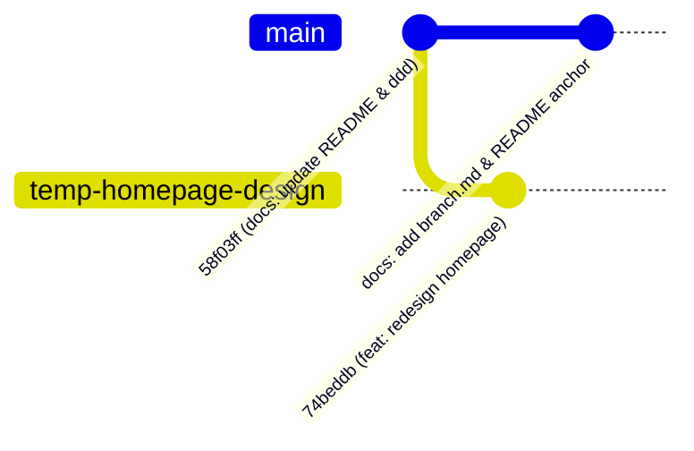

# 🌿 Git Dal Yönetimi ve Yaşam Döngüsü Rehberi (Branching Strategy)

[](https://github.com/rumeysa478/alumni)
[](https://github.com/rumeysa478/alumni/tree/temp-homepage-design)
[](https://github.com/rumeysa478/alumni)

> **Alumni Tracking System (Mezun Takip Sistemi)** projesinde kullanılan Git dallanma stratejisi, geçici özellik dallarının (temporary feature branches) oluşturulması, incelenmesi, test edilmesi ve kararlı ana dala (`main`) güvenle aktarılmasına ilişkin standart kılavuzdur.

---

## 📌 İçindekiler

1. [Genel Bakış ve Dallanma Felsefesi](#1-genel-bakış-ve-dallanma-felsefesi)
2. [Mevcut Dallar ve Sorumlulukları](#2-mevcut-dallar-ve-sorumlulukları)
3. [Geçici Dal: `temp-homepage-design`](#3-geçici-dal-temp-homepage-design)
   - [Oluşturulma Amacı](#oluşturulma-amacı)
   - [Yapılan Tasarım ve Kod Değişiklikleri](#yapılan-tasarım-ve-kod-değişiklikleri)
   - [Test Doğrulaması ve Değişmezler (Invariants)](#test-doğrulaması-ve-değişmezler-invariants)
4. [Git Dal İş Akışı ve Yaşam Döngüsü](#4-git-dal-iş-akışı-ve-yaşam-döngüsü)
5. [Adım Adım Komut Kılavuzu](#5-adım-adım-komut-kılavuzu)
   - [Geçici Dala Geçiş ve İnceleme](#geçici-dala-geçiş-ve-i̇nceleme)
   - [Ana Dala (`main`) Geri Dönüş](#ana-dala-main-geri-dönüş)
   - [Dallar Arası Farkları Görüntüleme (Diff)](#dallar-arası-farkları-görüntüleme-diff)
   - [Geçici Dalı `main` ile Birleştirme (Merge / PR)](#geçici-dalı-main-ile-birleştirme-merge--pr)
   - [Dalı Temizleme / Silme (Cleanup)](#dalı-temizleme--silme-cleanup)
6. [Dal İsimlendirme Kuralları (Naming Conventions)](#6-dal-i̇simlendirme-kuralları-naming-conventions)

---

## 1. Genel Bakış ve Dallanma Felsefesi

Alumni Tracking System projesinde **GitHub Flow** ve **Feature Branch Workflow** prensipleri benimsenmiştir:
- **Kararlı `main` Dalı:** Her zaman çalışan, tüm testleri geçen ve sunucuya dağıtıma hazır kararlı üretim kodunu barındırır.
- **İzole Geliştirme (Isolation):** Deneysel tasarım değişiklikleri, yeni görsel arayüzler ve büyük özellikler doğrudan `main` üzerinde yapılmaz; geçici veya amaca özel dallarda geliştirilir.
- **Doğrulama ve Geri Dönüş Güvencesi:** Geçici dalda yapılan çalışmalar test edilip onaylandıktan sonra ana dala birleştirilir veya gerek duyulmazsa `main` dalı hiç etkilenmeden güvenle terk edilebilir.

---

## 2. Mevcut Dallar ve Sorumlulukları

| Dal Adı | Dal Türü | Durum | Rol ve Sorumluluk |
| :--- | :--- | :--- | :--- |
| **`main`** | Default / Production | 🟢 Aktif | Projenin ana, kararlı ve dağıtıma hazır dalıdır. Express sunucusu, EJS MVC arayüzleri, REST API ve dokümantasyonu barındırır. |
| **`temp-homepage-design`** | Temporary / Feature | 🟡 İncelenmeye Hazır | Ana sayfanın (`public/index.html`) CONNEXT görsel kimliğine uygun olarak yeniden tasarlanması, canlı istatistik kartları, hızlı eylem hapları ve vitrin modüllerinin eklendiği geçici tasarım dalıdır. |

---

## 3. Geçici Dal: `temp-homepage-design`

### Oluşturulma Amacı
Kullanıcı talebi doğrultusunda, ana daldaki kararlı yapıyı riske atmadan ana sayfayı (`public/index.html`) zenginleştirmek, modern bir estetik kazandırmak ve görsel hiyerarşiyi geliştirmek amacıyla açılmıştır:

```bash
git checkout -b temp-homepage-design
```

### Yapılan Tasarım ve Kod Değişiklikleri
Bu dal üzerinde [`public/index.html`](file:///c:/Users/rumeysa.aydin/Desktop/alumni/public/index.html) dosyası baştan sona yeniden tasarlanmış ve aşağıdaki yeni bileşenler eklenmiştir:

1. **Gelişmiş CONNEXT Hero Alanı:**
   - Tarihi Beyazıt Kapısı silüeti üzerine modern gün batımı degrade arka planı (`--connext-gradient`).
   - "İSTANBUL UNIVERSITY ALUMNI WEB PAGE" başlığı ve kurumsal açıklama metni.
   - Giriş Yap ("Log In") ve Kayıt Ol ("Sign In") birincil aksiyon hapları.
2. **Canlı İstatistik Kartları Grid'i (`.stats-card-grid`):**
   - 🎓 `12,450+` Kayıtlı Mezun & Öğrenci
   - 💼 `850+` Aktif İş & Staj Fırsatı
   - 🤝 `1,280+` Tamamlanan Mentörlük Eşleşmesi
   - 📅 `95+` Yıllık Etkinlik & Buluşma
3. **Hızlı Filtreleme ve Navigasyon Hapları (`.quick-actions-bar`):**
   - Mezun Rehberi, İş & Staj Fırsatları, Başvuru Takibi, Etkinlik Takvimi, Duyurular ve Swagger API hızlı bağlantıları.
4. **Frosty Franklin & Rumeysa Aydın Spotlight Profili:**
   - 3x5'lik 15 adet interaktif buton matrisi (`events`, `follow`, `send DM`, `posts`, `cv`, `experience`, `skills` vb.).
5. **İkili Vitrin Modülü (`.showcase-dual-section`):**
   - **Öne Çıkan İş & Staj İlanları:** Node.js Developer, Veri Analitiği, Yapay Zeka Araştırmacısı canlı önizlemeleri.
   - **Yaklaşan Etkinlikler & Buluşmalar:** Mezunlar Balosu, Kariyer Zirvesi, Mentörlük Sohbetleri önizlemeleri.
6. **Sistem ve API Hızlı Erişim Dock'u (`.system-dock`):**
   - Yeşil yanıp sönen sistem durumu indikatörü (`Sistem Durumu: Çalışıyor UP`).
   - Swagger UI, OpenAPI JSON ve Generic 404 sayfasına tek tıkla erişim.

### Test Doğrulaması ve Değişmezler (Invariants)
Yeni tasarımda otomatik testlerin gereksinim duyduğu tüm değişmez metinler (`invariants`) titizlikle korunmuştur:
- `body.includes('Alumni Tracking System')` ✅
- `body.includes('temporary home page')` ✅

> [!NOTE]
> `temp-homepage-design` dalında çalıştırılan `npm test` komutu sonucunda **59 testin 59'u da başarıyla geçmiştir**.

---

## 4. Git Dal İş Akışı ve Yaşam Döngüsü

Aşağıdaki Mermaid diyagramı, geçici dalın oluşturulması, ana daldan ayrılması ve yaşam döngüsünü görselleştirmektedir:



---

## 5. Adım Adım Komut Kılavuzu

### Geçici Dala Geçiş ve İnceleme
Geçici tasarım dalına geçmek ve tasarımı yerel tarayıcınızda canlı görmek için:

```bash
# 1. Geçici dala geçiş yapın:
git checkout temp-homepage-design

# veya modern Git komutu ile:
git switch temp-homepage-design

# 2. Uygulamayı başlatın:
npm run dev
# Tarayıcınızda http://localhost:5000 adresini açarak yeni ana sayfa tasarımını inceleyin.
```

---

### Ana Dala (`main`) Geri Dönüş
Geçici daldaki işiniz bittiğinde kararlı ana dala geri dönmek için:

```bash
git checkout main

# veya:
git switch main
```

---

### Dallar Arası Farkları Görüntüleme (Diff)
`main` ile `temp-homepage-design` arasındaki kod farklarını terminalde incelemek için:

```bash
# Değişen dosyaların ve satır sayılarının özeti:
git diff --stat main..temp-homepage-design

# Ayrıntılı kod farkı (renkli diff):
git diff main..temp-homepage-design public/index.html
```

---

### Geçici Dalı `main` ile Birleştirme (Merge / PR)
Yeni ana sayfa tasarımını kararlı ana dala kalıcı olarak aktarmak istediğinizde:

#### Seçenek A: Yerel Merge (Local Fast-Forward / Merge Commit)
```bash
# 1. Ana dalda olduğunuzdan emin olun:
git checkout main

# 2. Geçici dalı main ile birleştirin:
git merge temp-homepage-design

# 3. Testlerin geçtiğini doğrulayın:
npm test

# 4. GitHub'a pushlayın:
git push origin main
```

#### Seçenek B: GitHub Pull Request (Önerilen)
1. GitHub deposuna gidin: [https://github.com/rumeysa478/alumni](https://github.com/rumeysa478/alumni)
2. `Compare & pull request` butonuna tıklayın (`temp-homepage-design` -> `main`).
3. Kod incelemesi sonrası `Merge pull request` aksiyonu ile birleştirin.

---

### Dalı Temizleme / Silme (Cleanup)
Tasarım ana dala birleştirildikten sonra geçici dal güvenle silinebilir:

```bash
# Yerel geçici dalı silmek için:
git branch -d temp-homepage-design

# GitHub üzerindeki uzak dalı silmek için:
git push origin --delete temp-homepage-design
```

---

## 6. Dal İsimlendirme Kuralları (Naming Conventions)

Gelecekteki geliştirmelerde karışıklığı önlemek için aşağıdaki ön ekler standarda bağlanmıştır:

- `feature/<ozellik-adi>`: Uzun soluklu yeni özellik ve modül geliştirmeleri (Örn: `feature/socket-chat`).
- `temp-<calisma-adi>`: İnceleme ve deneysel amaçlı açılan, merge sonrası silinecek geçici dallar (Örn: `temp-homepage-design`).
- `fix/<hata-adi>`: Hata düzeltme ve yama dalları (Örn: `fix/cors-header`).
- `docs/<konu-adi>`: Dokümantasyon ve şema güncellemeleri (Örn: `docs/swagger-update`).

---

[⬅️ Ana Dokümantasyona Dön (README.md)](./README.md)
