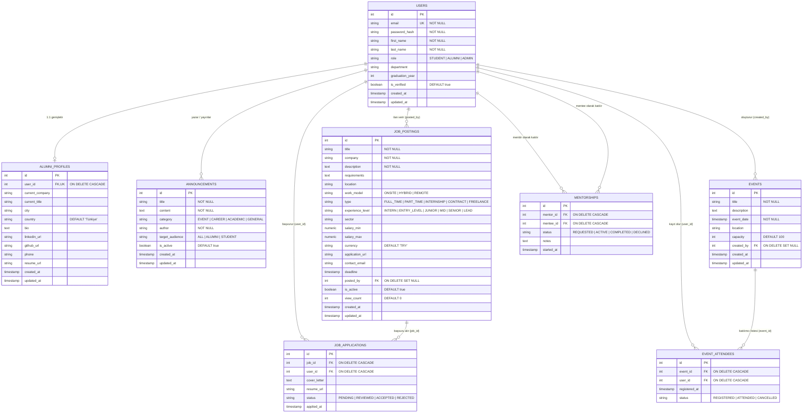

# 📊 Data Design Documentation (DDD)
## Mezun Takip Sistemi — Alumni Tracking System

[⬅️ Ana Proje Dokümantasyonuna Dön (README.md)](./README.md)

---

## 📌 İçindekiler
1. [Giriş ve Veri Mimarisi](#1-giriş-ve-veri-mimarisi)
2. [Varlık-İlişki Diyagramı (Entity-Relationship Diagram)](#2-varlık-ilişki-diyagramı-erd)
3. [Veri Sözlüğü ve Tablo Tanımları (Data Dictionary)](#3-veri-sözlüğü-ve-tablo-tanımları)
   - [3.1. users (Kullanıcılar)](#31-users-kullanıcılar)
   - [3.2. alumni_profiles (Mezun Profilleri)](#32-alumni_profiles-mezun-profilleri)
   - [3.3. announcements (Duyurular)](#33-announcements-duyurular)
   - [3.4. job_postings (İş ve Staj İlanları)](#34-job_postings-iş-ve-staj-ilanları)
   - [3.5. job_applications (İş Başvuruları)](#35-job_applications-iş-başvuruları)
   - [3.6. events (Etkinlikler)](#36-events-etkinlikler)
   - [3.7. event_attendees (Etkinlik Katılımcıları)](#37-event_attendees-etkinlik-katılımcıları)
   - [3.8. mentorships (Mentörlük Eşleşmeleri)](#38-mentorships-mentörlük-eşleşmeleri)
4. [Kardinalite ve İlişki Kuralları](#4-kardinalite-ve-ilişki-kuralları)
5. [Normalizasyon Analizi (1NF, 2NF, 3NF)](#5-normalizasyon-analizi-1nf-2nf-3nf)
6. [İndeksleme ve Performans Stratejisi](#6-i̇ndeksleme-ve-performans-stratejisi)
7. [🌟 The Forgetting Test Sırrı (Veri Kalıcılığı / Data Persistence)](#7--the-forgetting-test-sırrı-veri-kalıcılığı)
   - [Testin Mantığı ve Problem](#testin-mantığı-ve-problem)
   - [Sır: Docker İsimlendirilmiş Birimleri (Named Volumes)](#sır-docker-i̇simlendirilmiş-birimleri-named-volumes)
   - [Adım Adım Test Senaryosu (Doğrulama Kılavuzu)](#adım-adım-test-senaryosu-doğrulama-kılavuzu)
8. [PostgreSQL DDL Şema Tanımı (SQL Script)](#8-postgresql-ddl-şema-tanımı-sql-script)
9. [Migration ve Veritabanı Üretim Sistemi (Automated Migrations)](#9-migration-ve-veritabanı-üretim-sistemi)

---

## 1. Giriş ve Veri Mimarisi

**Alumni Tracking System (Mezun Takip Sistemi)**, mezunlar, öğrenciler, yöneticiler ve şirketler arasındaki etkileşimi yöneten ilişkisel bir veri mimarisine sahiptir.

### Temel Mimari Kararları:
- **Veritabanı Yönetim Sistemi:** **PostgreSQL 15+** (ACID standartlarına tam uyum, güçlü indeksleme motoru, JSONB ve tam metin arama desteği).
- **Karakter Seti & Kodlama:** `UTF-8` (Çok dilli karakter ve Türkçe karakter desteği).
- **Zaman Dilimi Yönetimi:** Tüm zaman damgaları `TIMESTAMP WITH TIME ZONE (TIMESTAMPTZ)` formatında UTC olarak saklanır.
- **ORM / Veri Erişim Katmanı:** Modüler MVC mimarisi altında sorgu optimizasyonu sağlayan `pg` (node-postgres) havuzlama (Connection Pooling) ve `SQL/Prisma/Sequelize` uyumlu şema.

---

## 2. Varlık-İlişki Diyagramı (ERD)

Aşağıdaki şemada sistemdeki ana varlıklar, aralarındaki 1:1, 1:N ve N:M ilişkiler ile temel kısıtlamalar gösterilmektedir:



---

## 3. Veri Sözlüğü ve Tablo Tanımları

### 3.1. `users` (Kullanıcılar)
Sisteme erişen tüm aktörlerin (Öğrenci, Mezun, Admin) temel kimlik doğrulama ve genel profil bilgilerini saklar.

| Sütun Adı | Veri Tipi | Kısıtlamalar (Constraints) | Varsayılan | Açıklama |
| :--- | :--- | :--- | :--- | :--- |
| `id` | `SERIAL` | `PRIMARY KEY` | Otomatik artan | Benzersiz kullanıcı ID'si |
| `email` | `VARCHAR(255)` | `UNIQUE`, `NOT NULL` | - | Kullanıcı kurumsal veya şahsi e-posta adresi |
| `password_hash` | `VARCHAR(255)` | `NOT NULL` | - | Bcrypt ile tuzlanmış şifre özeti |
| `first_name` | `VARCHAR(100)` | `NOT NULL` | - | Kullanıcının adı |
| `last_name` | `VARCHAR(100)` | `NOT NULL` | - | Kullanıcının soyadı |
| `role` | `VARCHAR(20)` | `NOT NULL`, `CHECK (role IN ('STUDENT', 'ALUMNI', 'ADMIN'))` | `'ALUMNI'` | Yetkilendirme rolü |
| `department` | `VARCHAR(150)` | - | `NULL` | Mezun olunan veya okunan üniversite bölümü |
| `graduation_year`| `INT` | `CHECK (graduation_year >= 1950 AND graduation_year <= 2100)` | `NULL` | Mezuniyet yılı (veya beklenen mezuniyet) |
| `is_verified` | `BOOLEAN` | `NOT NULL` | `TRUE` | Yönetici veya e-posta doğrulama durumu |
| `created_at` | `TIMESTAMPTZ` | `NOT NULL` | `CURRENT_TIMESTAMP` | Kayıt tarihi |
| `updated_at` | `TIMESTAMPTZ` | `NOT NULL` | `CURRENT_TIMESTAMP` | Son güncelleme tarihi |

---

### 3.2. `alumni_profiles` (Mezun Profilleri)
Yalnızca mezun kullanıcılara özel detaylı iş, kariyer ve iletişim bilgilerini saklar. `users` tablosuyla **1:1** ilişkilidir.

| Sütun Adı | Veri Tipi | Kısıtlamalar | Varsayılan | Açıklama |
| :--- | :--- | :--- | :--- | :--- |
| `id` | `SERIAL` | `PRIMARY KEY` | Otomatik artan | Profil ID'si |
| `user_id` | `INT` | `UNIQUE`, `NOT NULL`, `REFERENCES users(id) ON DELETE CASCADE` | - | İlgili kullanıcıya yabancı anahtar |
| `current_company`| `VARCHAR(150)`| - | `NULL` | Şu an çalışılan kurum / şirket |
| `current_title` | `VARCHAR(150)`| - | `NULL` | Mevcut unvan / pozisyon |
| `city` | `VARCHAR(100)`| - | `NULL` | İkamet edilen şehir |
| `country` | `VARCHAR(100)`| - | `'Türkiye'` | İkamet edilen ülke |
| `bio` | `TEXT` | - | `NULL` | Mezun hakkında kısa özgeçmiş / tanıtım yazısı |
| `linkedin_url` | `VARCHAR(255)`| - | `NULL` | LinkedIn profil bağlantısı |
| `github_url` | `VARCHAR(255)`| - | `NULL` | GitHub profil bağlantısı |
| `phone` | `VARCHAR(30)` | - | `NULL` | İletişim telefon numarası |
| `resume_url` | `VARCHAR(255)`| - | `NULL` | Sunucuya yüklenen PDF CV dosya yolu |
| `created_at` | `TIMESTAMPTZ` | `NOT NULL` | `CURRENT_TIMESTAMP` | Profil oluşturulma tarihi |
| `updated_at` | `TIMESTAMPTZ` | `NOT NULL` | `CURRENT_TIMESTAMP` | Profil güncellenme tarihi |

---

### 3.3. `announcements` (Duyurular)
Koordinatörlük ve yöneticiler tarafından paylaşılan duyuruları, etkinlik bildirimlerini ve akademik haberleri saklar.

| Sütun Adı | Veri Tipi | Kısıtlamalar | Varsayılan | Açıklama |
| :--- | :--- | :--- | :--- | :--- |
| `id` | `SERIAL` | `PRIMARY KEY` | Otomatik artan | Duyuru ID'si |
| `title` | `VARCHAR(255)`| `NOT NULL` | - | Duyuru başlığı |
| `content` | `TEXT` | `NOT NULL` | - | Duyuru detay metni |
| `category` | `VARCHAR(50)` | `NOT NULL`, `CHECK (category IN ('EVENT', 'CAREER', 'ACADEMIC', 'GENERAL'))` | `'GENERAL'` | Duyuru kategorisi |
| `author` | `VARCHAR(100)`| `NOT NULL` | `'Sistem Yöneticisi'` | Duyuruyu yayınlayan birim / kişi |
| `target_audience`| `VARCHAR(20)` | `NOT NULL`, `CHECK (target_audience IN ('ALL', 'ALUMNI', 'STUDENT'))` | `'ALL'` | Hedef kitle filtresi |
| `is_active` | `BOOLEAN` | `NOT NULL` | `TRUE` | Yayın aktiflik durumu |
| `created_at` | `TIMESTAMPTZ` | `NOT NULL` | `CURRENT_TIMESTAMP` | Yayınlanma tarihi |
| `updated_at` | `TIMESTAMPTZ` | `NOT NULL` | `CURRENT_TIMESTAMP` | Güncellenme tarihi |

---

### 3.4. `job_postings` (İş ve Staj İlanları)
Mezunlar ve işveren partnerler tarafından paylaşılan iş, staj ve kariyer fırsatlarını yönetir. Modern kariyer portalları standartlarına uygun olarak çalışma modeli (hibrit/uzaktan), deneyim seviyesi, sektör, maaş aralığı ve doğrudan başvuru kanalları (harici URL / e-posta) ile zenginleştirilmiştir.

| Sütun Adı | Veri Tipi | Kısıtlamalar | Varsayılan | Açıklama |
| :--- | :--- | :--- | :--- | :--- |
| `id` | `SERIAL` | `PRIMARY KEY` | Otomatik artan | Benzersiz ilan ID'si |
| `title` | `VARCHAR(200)`| `NOT NULL` | - | Pozisyon başlığı (örn: Full Stack Developer, Veri Analisti) |
| `company` | `VARCHAR(150)`| `NOT NULL` | - | İlanı veren firma / kurum adı |
| `description` | `TEXT` | `NOT NULL` | - | Pozisyon özeti, görev ve sorumluluklar |
| `requirements` | `TEXT` | - | `NULL` | Aranan teknik yetkinlikler, eğitim şartı ve nitelikler |
| `location` | `VARCHAR(100)`| - | `NULL` | Şehir ve lokasyon bilgisi (örn: İstanbul, ODTÜ Teknokent) |
| `work_model` | `VARCHAR(50)` | `CHECK (work_model IN ('ONSITE', 'HYBRID', 'REMOTE'))` | `'HYBRID'` | Çalışma ortamı modeli (Ofisten, Hibrit, Uzaktan) |
| `type` | `VARCHAR(50)` | `CHECK (type IN ('FULL_TIME', 'PART_TIME', 'INTERNSHIP', 'CONTRACT', 'FREELANCE'))` | `'FULL_TIME'` | İstihdam türü / çalışma şekli |
| `experience_level`| `VARCHAR(50)` | `CHECK (experience_level IN ('INTERN', 'ENTRY_LEVEL', 'JUNIOR', 'MID', 'SENIOR', 'LEAD'))` | `'MID'` | Hedeflenen tecrübe seviyesi |
| `sector` | `VARCHAR(100)`| - | `NULL` | Faaliyet sektörü (örn: Yazılım & Bilişim, Siber Güvenlik, Finans) |
| `salary_min` | `NUMERIC(12, 2)` | `CHECK (salary_min >= 0)` | `NULL` | Minimum maaş beklentisi / alt skala |
| `salary_max` | `NUMERIC(12, 2)` | `CHECK (salary_max >= 0)` | `NULL` | Maksimum maaş üst sınırı |
| `currency` | `VARCHAR(10)` | - | `'TRY'` | Maaş para birimi (TRY, USD, EUR) |
| `application_url` | `VARCHAR(255)`| - | `NULL` | Harici başvuru bağlantısı (LinkedIn, Kariyer.net, Kurumsal portal) |
| `contact_email` | `VARCHAR(255)`| - | `NULL` | İlan sorumlusu iletişim ve CV gönderim e-posta adresi |
| `deadline` | `TIMESTAMPTZ` | - | `NULL` | Son başvuru kabul tarihi |
| `posted_by` | `INT` | `REFERENCES users(id) ON DELETE SET NULL` | `NULL` | İlanı sisteme giren mezun veya yönetici ID |
| `is_active` | `BOOLEAN` | `NOT NULL` | `TRUE` | İlanın aktif olarak yayında olup olmadığı |
| `view_count` | `INT` | `CHECK (view_count >= 0)` | `0` | İlanın görüntülenme / tıklanma sayısı |
| `created_at` | `TIMESTAMPTZ` | `NOT NULL` | `CURRENT_TIMESTAMP` | İlanın yayınlanma tarihi |
| `updated_at` | `TIMESTAMPTZ` | `NOT NULL` | `CURRENT_TIMESTAMP` | Son güncelleme tarihi |

*Tablo Kısıtları:*
- `CONSTRAINT chk_job_salary_range CHECK (salary_min IS NULL OR salary_max IS NULL OR salary_min <= salary_max)` — Minimum maaş, maksimum maaştan büyük olamaz.
- `work_model` ve `type` alanlarının ayrıştırılması sayesinde istihdam biçimi (`FULL_TIME`, `INTERNSHIP`) ile çalışma lokasyonu modeli (`REMOTE`, `HYBRID`, `ONSITE`) birbirine karışmaz.

---

### 3.5. `job_applications` (İş Başvuruları)
Öğrenci ve mezunların iş ilanlarına yaptıkları başvuruları tutan **N:M (Çoka-Çok)** köprü tablosudur.

| Sütun Adı | Veri Tipi | Kısıtlamalar | Varsayılan | Açıklama |
| :--- | :--- | :--- | :--- | :--- |
| `id` | `SERIAL` | `PRIMARY KEY` | Otomatik artan | Başvuru ID'si |
| `job_id` | `INT` | `NOT NULL`, `REFERENCES job_postings(id) ON DELETE CASCADE` | - | İlgili iş ilanı ID |
| `user_id` | `INT` | `NOT NULL`, `REFERENCES users(id) ON DELETE CASCADE` | - | Başvuran kullanıcı ID |
| `cover_letter` | `TEXT` | - | `NULL` | Ön yazı / niyet mektubu |
| `resume_url` | `VARCHAR(255)`| - | `NULL` | Başvuruya eklenen özgeçmiş dosyası |
| `status` | `VARCHAR(50)` | `CHECK (status IN ('PENDING', 'REVIEWED', 'ACCEPTED', 'REJECTED'))` | `'PENDING'` | Başvuru değerlendirme durumu |
| `applied_at` | `TIMESTAMPTZ` | `NOT NULL` | `CURRENT_TIMESTAMP` | Başvuru zamanı |

*Kısıt:* `UNIQUE (job_id, user_id)` — Bir kullanıcı aynı ilana yalnızca bir kez başvurabilir.

---

### 3.6. `events` (Etkinlikler)
Mezun buluşmaları, kariyer günleri, seminer ve webinarları içerir.

| Sütun Adı | Veri Tipi | Kısıtlamalar | Varsayılan | Açıklama |
| :--- | :--- | :--- | :--- | :--- |
| `id` | `SERIAL` | `PRIMARY KEY` | Otomatik artan | Etkinlik ID'si |
| `title` | `VARCHAR(200)`| `NOT NULL` | - | Etkinlik başlığı |
| `description` | `TEXT` | - | `NULL` | Etkinlik içerik ve programı |
| `event_date` | `TIMESTAMPTZ` | `NOT NULL` | - | Etkinlik tarihi ve saati |
| `location` | `VARCHAR(200)`| - | `NULL` | Yer (Amfi, Salon, Zoom bağlantısı) |
| `capacity` | `INT` | `CHECK (capacity >= 0)` | `100` | Kontenjan |
| `created_by` | `INT` | `REFERENCES users(id) ON DELETE SET NULL` | `NULL` | Etkinliği düzenleyen kullanıcı |
| `created_at` | `TIMESTAMPTZ` | `NOT NULL` | `CURRENT_TIMESTAMP` | Oluşturulma tarihi |
| `updated_at` | `TIMESTAMPTZ` | `NOT NULL` | `CURRENT_TIMESTAMP` | Güncellenme tarihi |

---

### 3.7. `event_attendees` (Etkinlik Katılımcıları)
Kullanıcıların etkinliklere kayıtlarını ve katılım durumlarını tutan **N:M (Çoka-Çok)** köprü tablosudur.

| Sütun Adı | Veri Tipi | Kısıtlamalar | Varsayılan | Açıklama |
| :--- | :--- | :--- | :--- | :--- |
| `id` | `SERIAL` | `PRIMARY KEY` | Otomatik artan | Katılım kaydı ID'si |
| `event_id` | `INT` | `NOT NULL`, `REFERENCES events(id) ON DELETE CASCADE` | - | Etkinlik ID |
| `user_id` | `INT` | `NOT NULL`, `REFERENCES users(id) ON DELETE CASCADE` | - | Katılımcı kullanıcı ID |
| `registered_at`| `TIMESTAMPTZ` | `NOT NULL` | `CURRENT_TIMESTAMP` | Kayıt tarihi |
| `status` | `VARCHAR(50)` | `CHECK (status IN ('REGISTERED', 'ATTENDED', 'CANCELLED'))` | `'REGISTERED'` | Katılım durumu |

*Kısıt:* `UNIQUE (event_id, user_id)` — Bir kullanıcı bir etkinliğe tek kayıt yaptırabilir.

---

### 3.8. `mentorships` (Mentörlük Eşleşmeleri)
Deneyimli mezunlar ile öğrenciler veya yeni mezunlar arasındaki mentör-mentee ilişkilerini yönetir.

| Sütun Adı | Veri Tipi | Kısıtlamalar | Varsayılan | Açıklama |
| :--- | :--- | :--- | :--- | :--- |
| `id` | `SERIAL` | `PRIMARY KEY` | Otomatik artan | Mentörlük ilişki ID'si |
| `mentor_id` | `INT` | `NOT NULL`, `REFERENCES users(id) ON DELETE CASCADE` | - | Mentör olan kullanıcı |
| `mentee_id` | `INT` | `NOT NULL`, `REFERENCES users(id) ON DELETE CASCADE` | - | Mentee olan kullanıcı |
| `status` | `VARCHAR(50)` | `CHECK (status IN ('REQUESTED', 'ACTIVE', 'COMPLETED', 'DECLINED'))` | `'REQUESTED'` | İlişki durumu |
| `notes` | `TEXT` | - | `NULL` | Görüşme notları ve hedefler |
| `started_at` | `TIMESTAMPTZ` | `NOT NULL` | `CURRENT_TIMESTAMP` | Başlama tarihi |

*Kısıt:* `CHECK (mentor_id <> mentee_id)` — Bir kullanıcı kendi kendisinin mentörü olamaz.

---

## 4. Kardinalite, İlişki Kuralları ve Model Mimarisi

### 4.1. Veritabanı Düzeyi İlişki Tablosu

| Varlık 1 | İlişki Türü | Varlık 2 | Silinme Davranışı (ON DELETE) | Gerekçe |
| :--- | :---: | :--- | :--- | :--- |
| `users` | **1 : 1** | `alumni_profiles` | `CASCADE` | Kullanıcı hesabı silinirse profil verisi de silinmelidir. |
| `users` | **1 : N** | `job_postings` | `SET NULL` | İlanı oluşturan kullanıcı silinse dahi yayınlanan iş ilanı arşivde kalabilir. |
| `users` | **N : M** | `job_postings` | `CASCADE` (`job_applications` üzerinden) | İlan veya kullanıcı silindiğinde başvuru bağı silinir. |
| `users` | **1 : N** | `events` | `SET NULL` | Etkinliği oluşturan organizatör silinse de etkinlik kaydı korunur. |
| `users` | **N : M** | `events` | `CASCADE` (`event_attendees` üzerinden) | Etkinlik iptal edilirse tüm katılımcı kayıtları temizlenir. |
| `users` (mentor) | **1 : N** | `mentorships` | `CASCADE` | Kullanıcı ayrıldığında mentörlük ilişkisi sonlandırılır. |
| `users` (mentee) | **1 : N** | `mentorships` | `CASCADE` | Kullanıcı ayrıldığında mentörlük ilişkisi sonlandırılır. |

---

### 4.2. Uygulama Katmanı Modelleri ve İlişki Tanımları (`src/models/`)

Veritabanında tanımlanan 8 varlık için Node.js tarafında hibrit mimarili (PostgreSQL havuzu ve offline testler için In-Memory fallback destekli) **Model sınıfları** ve merkezi bir ilişki kütüphanesi ([`src/models/index.js`](./src/models/index.js)) tanımlanmıştır:

| Model Adı | Dosya | Tablo | İlişkiler (Associations) |
| :--- | :--- | :--- | :--- |
| `UserModel` | [`user.model.js`](./src/models/user.model.js) | `users` | `hasOne(Profile)`, `hasMany(JobPosting)`, `hasMany(JobApplication)`, `belongsToMany(JobPosting)`, `hasMany(Event)`, `belongsToMany(Event)`, `hasMany(Mentorship)` |
| `AlumniProfileModel` | [`alumniProfile.model.js`](./src/models/alumniProfile.model.js) | `alumni_profiles` | `belongsTo(User, { foreignKey: 'user_id' })` |
| `AnnouncementModel` | [`announcement.model.js`](./src/models/announcement.model.js) | `announcements` | Bağımsız genel duyuru modeli |
| `JobPostingModel` | [`jobPosting.model.js`](./src/models/jobPosting.model.js) | `job_postings` | `belongsTo(User, { as: 'poster' })`, `hasMany(JobApplication)`, `belongsToMany(User, { as: 'applicants' })` |
| `JobApplicationModel` | [`jobApplication.model.js`](./src/models/jobApplication.model.js) | `job_applications` | `belongsTo(JobPosting)`, `belongsTo(User)` *(N:M Pivot)* |
| `EventModel` | [`event.model.js`](./src/models/event.model.js) | `events` | `belongsTo(User, { as: 'organizer' })`, `hasMany(EventAttendee)`, `belongsToMany(User, { as: 'participants' })` |
| `EventAttendeeModel` | [`eventAttendee.model.js`](./src/models/eventAttendee.model.js) | `event_attendees` | `belongsTo(Event)`, `belongsTo(User)` *(N:M Pivot)* |
| `MentorshipModel` | [`mentorship.model.js`](./src/models/mentorship.model.js) | `mentorships` | `belongsTo(User, { as: 'mentor' })`, `belongsTo(User, { as: 'mentee' })` |

#### Programatik İlişki Gezinimi (Relational Loader Methods):
```javascript
import { userModel, jobPostingModel, eventModel, mentorshipModel } from './src/models/index.js';

// 1:1 — Kullanıcının profilini çekme
const profile = await userModel.getProfile(userId);

// 1:N — İlanı oluşturan mezunu çekme
const poster = await jobPostingModel.getPoster(jobId);

// N:M — İlana başvuran adayların ve başvuru detaylarının listesi
const applicants = await jobPostingModel.getApplicants(jobId);

// N:M — Bir etkinliğin kayıtlı katılımcılarını çekme
const participants = await eventModel.getParticipants(eventId);

// 1:N Self-referential — Kullanıcının aktif mentörlük eşleşmeleri
const mentorships = await mentorshipModel.getByUser(userId);
```

---

## 5. Normalizasyon Analizi (1NF, 2NF, 3NF)

Veritabanı tasarımımız 3. Normal Form (3NF) gereksinimlerini eksiksiz karşılayacak şekilde normalize edilmiştir:

### 1. Normal Form (1NF) — Atomik Değerler
- Her sütun yalnızca **tek ve bölünemez (atomik)** değer içerir.
- Örneğin; ad ve soyad `first_name` ve `last_name` olarak ayrılmıştır.
- Çoklu telefon, adres veya beceri listeleri tek sütunda virgülle saklanmaz; ilişkili tablolara aktarılmıştır.
- Tüm tablolarda tekil bir `PRIMARY KEY` tanımlanmıştır.

### 2. Normal Form (2NF) — Tam Fonksiyonel Bağımlılık
- Tablolar 1NF kurallarına uygundur.
- Bileşik anahtara (Composite PK) sahip köprü tablolarında (`job_applications`, `event_attendees`) anahtar olmayan tüm alanlar (`status`, `applied_at`, `registered_at`) bileşik anahtarın tamamına bağımlıdır, kısmi bağımlılık (partial dependency) yoktur.

### 3. Normal Form (3NF) — Geçişsiz Bağımlılıkların Önlenmesi (Transitive Dependency)
- Tablolar 2NF kurallarına uygundur.
- Birincil anahtar haricindeki hiçbir alan, anahtar olmayan başka bir alana bağımlı değildir.
- Örneğin: `users` tablosunda kullanıcının şirket bilgisi, LinkedIn adresi veya unvanı doğrudan tutulmaz; bu veriler `alumni_profiles` tablosuna ayrıştırılarak geçişsiz fonksiyonel bağımlılıklar ortadan kaldırılmıştır.

---

## 6. İndeksleme ve Performans Stratejisi

Sık sorgulanan sütunlar ve yabancı anahtarlar (Foreign Keys) üzerinde **B-Tree** indeksleri oluşturulmuştur:

```sql
-- Sık filtreleme ve oturum açma sorguları için:
CREATE INDEX idx_users_email ON users(email);
CREATE INDEX idx_users_role ON users(role);
CREATE INDEX idx_users_department ON users(department);
CREATE INDEX idx_users_graduation_year ON users(graduation_year);

-- Duyuru kategori filtrelemeleri ve aktiflik durumu:
CREATE INDEX idx_announcements_category ON announcements(category);
CREATE INDEX idx_announcements_is_active ON announcements(is_active);

-- İlan filtreleme ve yabancı anahtar aramaları:
CREATE INDEX idx_job_postings_posted_by ON job_postings(posted_by);
CREATE INDEX idx_job_postings_type ON job_postings(type);
CREATE INDEX idx_job_postings_work_model ON job_postings(work_model);
CREATE INDEX idx_job_postings_experience_level ON job_postings(experience_level);
CREATE INDEX idx_job_postings_sector ON job_postings(sector);
CREATE INDEX idx_job_postings_is_active ON job_postings(is_active);
CREATE INDEX idx_job_postings_deadline ON job_postings(deadline);

-- Etkinlik tarih sıralaması:
CREATE INDEX idx_events_date ON events(event_date);
```

---

## 7. 🌟 The Forgetting Test Sırrı (Veri Kalıcılığı)

### Testin Mantığı ve Problem
Docker ortamında veritabanı çalıştırırken yapılan en yaygın hata:
1. `docker compose up` ile PostgreSQL ayağa kaldırılır.
2. Bir veri veya kayıt eklenir (`INSERT INTO users ...`).
3. `docker compose down` komutu çalıştırılır (Konteyner durdurulur ve silinir).
4. `docker compose up` ile sistem tekrar başlatılır.
5. Veritabanı sorgulandığında az önce eklenen kayıt **yok olmuştur (UNUTULMUŞTUR)!** 😱

> **Problem:** Konteynerlerin varsayılan dosya sistemi geçicidir (ephemeral). Konteyner silindiğinde (`down`) içindeki veriler de silinir.

---

### Sır: Docker İsimlendirilmiş Birimleri (Named Volumes)

> 💡 **"The Forgetting Test" Sırrı Nedir?**  
> Verilerin konteyner yeniden başlatmalarında (`down` -> `up`) asla silinmemesi için **Docker Named Volume (İsimlendirilmiş Birim)** kullanılmasıdır.

`docker-compose.yml` dosyasında veritabanı servisimize tanımladığımız kalıcı birim:

```yaml
services:
  postgres_db:
    image: postgres:15-alpine
    volumes:
      # 🌟 THE FORGETTING TEST SECRET 🌟
      # Sol taraf: Host üzerindeki Docker Volume adı (postgres_data)
      # Sağ taraf: PostgreSQL konteyner içindeki veri dizini
      - postgres_data:/var/lib/postgresql/data

# Üst düzey named volume tanımı:
volumes:
  postgres_data:
    driver: local
```

#### Neden Başarılı Olur?
- `docker compose down`: Konteyneri kaldırır ancak **`postgres_data` birimini silmez**.
- `docker compose up`: Yeni bir PostgreSQL konteyneri ayağa kaldırır ve var olan `postgres_data` birimini ona bağlar. PostgreSQL tüm eski tabloları ve eklenmiş kayıtları anında tanır.
- ⚠️ **Kritik Not:** Verilerin bilinçli olarak sıfırlanması isteniyorsa `docker compose down -v` (`--volumes`) bayrağı kullanılmalıdır. Bu bayrak verilmediği sürece veriler asla unutulmaz!

---

### Adım Adım Test Senaryosu (Doğrulama Kılavuzu)

Aşağıdaki adımları uygulayarak "The Forgetting Test"i bizzat doğrulayabilirsiniz:

#### 1. Adım: Servisleri Ayağa Kaldırın
```bash
docker compose up -d
```

#### 2. Adım: Test Kaydı Oluşturun
REST API üzerinden yeni bir kullanıcı kaydı ekleyin:
```bash
curl -X POST http://localhost:5000/api/users \
  -H "Content-Type: application/json" \
  -d '{"first_name": "Kalıcı", "last_name": "TestKullanıcısı", "email": "kalici.test@alumni.edu", "password": "secure123Password", "role": "ALUMNI", "department": "Yazılım Mühendisliği", "graduation_year": 2025}'
```
*Veya PostgreSQL içerisine doğrudan SQL ile:*
```bash
docker compose exec postgres_db psql -U postgres -d alumni_db -c "INSERT INTO users (email, password_hash, first_name, last_name, role) VALUES ('kalici.test@alumni.edu', 'hash123', 'Kalıcı', 'TestKullanıcısı', 'ALUMNI');"
```

#### 3. Adım: Konteynerleri Tamamen Kapatın (down)
```bash
docker compose down
```
*(Bu komut konteynerleri ve ağları siler.)*

#### 4. Adım: Konteynerleri Tekrar Başlatın (up)
```bash
docker compose up -d
```

#### 5. Adım: Kaydı Kontrol Edin (Check Record)
Eklediğimiz kaydın silinmediğini teyit edin:
```bash
curl http://localhost:5000/api/users
```
*Veya PostgreSQL üzerinden:*
```bash
docker compose exec postgres_db psql -U postgres -d alumni_db -c "SELECT id, email, first_name, last_name FROM users WHERE email='kalici.test@alumni.edu';"
```
🎉 **Sonuç:** Kayıt eksiksiz olarak listede görüntülenir. Sistem "The Forgetting Test"i başarıyla geçmiştir!

---

## 8. PostgreSQL DDL Şema Tanımı (SQL Script)

Projede `docker/init.sql` dosyasında yer alan ve konteyner ilk açılışında otomatik çalışan DDL scripti:

```sql
-- 1. KULLANICILAR TABLOSU
CREATE TABLE IF NOT EXISTS users (
    id SERIAL PRIMARY KEY,
    email VARCHAR(255) UNIQUE NOT NULL,
    password_hash VARCHAR(255) NOT NULL,
    first_name VARCHAR(100) NOT NULL,
    last_name VARCHAR(100) NOT NULL,
    role VARCHAR(20) NOT NULL DEFAULT 'ALUMNI' CHECK (role IN ('STUDENT', 'ALUMNI', 'ADMIN')),
    department VARCHAR(150),
    graduation_year INT CHECK (graduation_year >= 1950 AND graduation_year <= 2100),
    is_verified BOOLEAN DEFAULT TRUE,
    created_at TIMESTAMP WITH TIME ZONE DEFAULT CURRENT_TIMESTAMP,
    updated_at TIMESTAMP WITH TIME ZONE DEFAULT CURRENT_TIMESTAMP
);

-- 2. MEZUN PROFİLLERİ (1:1 İLİŞKİ)
CREATE TABLE IF NOT EXISTS alumni_profiles (
    id SERIAL PRIMARY KEY,
    user_id INT UNIQUE NOT NULL REFERENCES users(id) ON DELETE CASCADE,
    current_company VARCHAR(150),
    current_title VARCHAR(150),
    city VARCHAR(100),
    country VARCHAR(100) DEFAULT 'Türkiye',
    bio TEXT,
    linkedin_url VARCHAR(255),
    github_url VARCHAR(255),
    phone VARCHAR(30),
    resume_url VARCHAR(255),
    created_at TIMESTAMP WITH TIME ZONE DEFAULT CURRENT_TIMESTAMP,
    updated_at TIMESTAMP WITH TIME ZONE DEFAULT CURRENT_TIMESTAMP
);

-- 3. DUYURULAR TABLOSU
CREATE TABLE IF NOT EXISTS announcements (
    id SERIAL PRIMARY KEY,
    title VARCHAR(255) NOT NULL,
    content TEXT NOT NULL,
    category VARCHAR(50) NOT NULL DEFAULT 'GENERAL' CHECK (category IN ('EVENT', 'CAREER', 'ACADEMIC', 'GENERAL')),
    author VARCHAR(100) NOT NULL DEFAULT 'Sistem Yöneticisi',
    target_audience VARCHAR(20) NOT NULL DEFAULT 'ALL' CHECK (target_audience IN ('ALL', 'ALUMNI', 'STUDENT')),
    is_active BOOLEAN DEFAULT TRUE,
    created_at TIMESTAMP WITH TIME ZONE DEFAULT CURRENT_TIMESTAMP,
    updated_at TIMESTAMP WITH TIME ZONE DEFAULT CURRENT_TIMESTAMP
);

-- 4. İŞ VE STAJ İLANLARI TABLOSU
CREATE TABLE IF NOT EXISTS job_postings (
    id SERIAL PRIMARY KEY,
    title VARCHAR(200) NOT NULL,
    company VARCHAR(150) NOT NULL,
    description TEXT NOT NULL,
    requirements TEXT,
    location VARCHAR(100),
    work_model VARCHAR(50) DEFAULT 'HYBRID' CHECK (work_model IN ('ONSITE', 'HYBRID', 'REMOTE')),
    type VARCHAR(50) DEFAULT 'FULL_TIME' CHECK (type IN ('FULL_TIME', 'PART_TIME', 'INTERNSHIP', 'CONTRACT', 'FREELANCE')),
    experience_level VARCHAR(50) DEFAULT 'MID' CHECK (experience_level IN ('INTERN', 'ENTRY_LEVEL', 'JUNIOR', 'MID', 'SENIOR', 'LEAD')),
    sector VARCHAR(100),
    salary_min NUMERIC(12, 2) CHECK (salary_min >= 0),
    salary_max NUMERIC(12, 2) CHECK (salary_max >= 0),
    currency VARCHAR(10) DEFAULT 'TRY',
    application_url VARCHAR(255),
    contact_email VARCHAR(255),
    deadline TIMESTAMP WITH TIME ZONE,
    posted_by INT REFERENCES users(id) ON DELETE SET NULL,
    is_active BOOLEAN DEFAULT TRUE,
    view_count INT DEFAULT 0 CHECK (view_count >= 0),
    created_at TIMESTAMP WITH TIME ZONE DEFAULT CURRENT_TIMESTAMP,
    updated_at TIMESTAMP WITH TIME ZONE DEFAULT CURRENT_TIMESTAMP,
    CONSTRAINT chk_job_salary_range CHECK (salary_min IS NULL OR salary_max IS NULL OR salary_min <= salary_max)
);

-- 5. İŞ BAŞVURULARI (N:M KÖPRÜ TABLOSU)
CREATE TABLE IF NOT EXISTS job_applications (
    id SERIAL PRIMARY KEY,
    job_id INT NOT NULL REFERENCES job_postings(id) ON DELETE CASCADE,
    user_id INT NOT NULL REFERENCES users(id) ON DELETE CASCADE,
    cover_letter TEXT,
    resume_url VARCHAR(255),
    status VARCHAR(50) DEFAULT 'PENDING' CHECK (status IN ('PENDING', 'REVIEWED', 'ACCEPTED', 'REJECTED')),
    applied_at TIMESTAMP WITH TIME ZONE DEFAULT CURRENT_TIMESTAMP,
    CONSTRAINT unique_job_user_application UNIQUE (job_id, user_id)
);

-- 6. ETKİNLİKLER TABLOSU
CREATE TABLE IF NOT EXISTS events (
    id SERIAL PRIMARY KEY,
    title VARCHAR(200) NOT NULL,
    description TEXT,
    event_date TIMESTAMP WITH TIME ZONE NOT NULL,
    location VARCHAR(200),
    capacity INT DEFAULT 100,
    created_by INT REFERENCES users(id) ON DELETE SET NULL,
    created_at TIMESTAMP WITH TIME ZONE DEFAULT CURRENT_TIMESTAMP,
    updated_at TIMESTAMP WITH TIME ZONE DEFAULT CURRENT_TIMESTAMP
);

-- 7. ETKİNLİK KATILIMCILARI (N:M KÖPRÜ TABLOSU)
CREATE TABLE IF NOT EXISTS event_attendees (
    id SERIAL PRIMARY KEY,
    event_id INT NOT NULL REFERENCES events(id) ON DELETE CASCADE,
    user_id INT NOT NULL REFERENCES users(id) ON DELETE CASCADE,
    registered_at TIMESTAMP WITH TIME ZONE DEFAULT CURRENT_TIMESTAMP,
    status VARCHAR(50) DEFAULT 'REGISTERED' CHECK (status IN ('REGISTERED', 'ATTENDED', 'CANCELLED')),
    CONSTRAINT unique_event_user_attendee UNIQUE (event_id, user_id)
);

-- 8. MENTÖRLÜK EŞLEŞMELERİ
CREATE TABLE IF NOT EXISTS mentorships (
    id SERIAL PRIMARY KEY,
    mentor_id INT NOT NULL REFERENCES users(id) ON DELETE CASCADE,
    mentee_id INT NOT NULL REFERENCES users(id) ON DELETE CASCADE,
    status VARCHAR(50) DEFAULT 'REQUESTED' CHECK (status IN ('REQUESTED', 'ACTIVE', 'COMPLETED', 'DECLINED')),
    notes TEXT,
    started_at TIMESTAMP WITH TIME ZONE DEFAULT CURRENT_TIMESTAMP,
    CONSTRAINT chk_mentor_not_mentee CHECK (mentor_id <> mentee_id)
);
```

---

## 9. Migration ve Veritabanı Üretim Sistemi

Dokümantasyonda tanımlanan ilişkisel veritabanı şemasını otomatik olarak oluşturmak, sürümlemek ve tohum verileri yüklemek için projede tam teşekküllü bir migration altyapısı geliştirilmiştir:

### Mimari Dosya Yapısı:
```plaintext
src/database/
├── connection.js                 # pg.Pool veritabanı bağlantı havuzu
├── migrate.js                    # Otomatik migration koşucusu (Schema Runner)
├── seed.js                       # Başlangıç örnek verilerini yükleyici (Seed Runner)
├── reset.js                      # Şemayı sıfırlayıp baştan kuran temizleme betiği
├── factories/                    # Veri Fabrikaları (Demo/Mock Veri Üreticileri)
│   ├── index.js                  # Toplu factory koşucusu ve demo seeder
│   ├── user.factory.js           # Gerçekçi mezun ve öğrenci veri fabrikası
│   ├── announcement.factory.js   # Duyuru şablonları ve veri fabrikası
│   └── job.factory.js            # İş ve staj ilanı veri fabrikası
├── migrations/
│   ├── 001_create_tables.sql              # ddd.md'deki 8 temel tablo ve indeksleri üreten DDL
│   └── 002_update_job_postings_table.sql  # job_postings tablosunu modern kariyer alanlarıyla güncelleyen DDL
└── seeds/
    └── 001_initial_seed.sql               # Başlangıç kullanıcı, profil, duyuru ve ilan verileri
```

### Komutlar:

#### 1. Veritabanı Şemasını ve Tabloları Üretme (Migration)
```bash
npm run db:migrate
```
- Hedef PostgreSQL veritabanı mevcut değilse otomatik olarak oluşturur (`CREATE DATABASE`).
- `_migrations` tablosunu kontrol eder ve yalnızca henüz uygulanmamış SQL migration dosyalarını atomik bir transaction (`BEGIN ... COMMIT`) içerisinde çalıştırır.

#### 2. Başlangıç Tohum Verilerini Yükleme (Seed)
```bash
npm run db:seed
```
- Sistemde test ve ilk kullanım için gerekli olan sabit örnek kullanıcıları, mezun profillerini, duyuruları ve iş ilanlarını yükler.

#### 3. Zengin ve Gerçekçi Demo Verileri Üretme (Factory)
```bash
npm run db:factory
```
- `UserFactory`, `AnnouncementFactory` ve `JobPostingFactory` şablonlarını kullanarak onlarca farklı, rastgele ve gerçekçi mezun profili, kariyer duyurusu ve staj ilanını tek komutla üretip veritabanına kaydeder.

#### 4. Veritabanını Tamamen Sıfırlama ve Yeniden Üretme (Reset)
```bash
npm run db:reset
```
- Tüm eski şemayı ve tabloları temizler (`DROP SCHEMA public CASCADE`), ardından migration ve seed işlemlerini sırayla baştan koşturur.

---

[⬅️ Ana Proje Dokümantasyonuna Dön (README.md)](./README.md)
